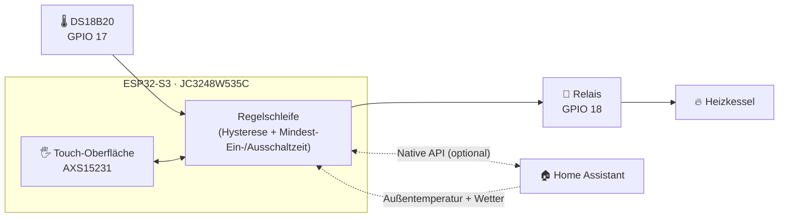

<div align="center">

# 🔥 ESP32-S3-Touchscreen-Thermostat und Gasheizkessel-Steuerung

### Eigenständiges ESPHome-Thermostat und Kesselsteuerung mit 3,5"-Touchscreen

[](https://esphome.io)
[](https://github.com/espressif/esp-idf)
[](https://www.home-assistant.io)
[](https://www.python.org)
[](LICENSE)
[](#️-roadmap)

| [English](./README.md) | [Română](./README.ro.md) | [Magyar](./README.hu.md) | [Polski](./README.pl.md) | [Deutsch](./README.de.md)

<br>

<div align="center">

[](https://www.youtube.com/watch?v=7YacdU6UZSM)

*Auf das Bild klicken, um eine kurze Demo des Thermostats in Aktion zu sehen*

</div>
</div>

---

> [!WARNING]
> **Netzspannung und Gasheizungsanlage. Lies den [Haftungsausschluss](#️-haftungsausschluss-und-sicherheit), bevor du irgendetwas baust.**

## 📑 Inhaltsverzeichnis

- [✨ Hauptfunktionen](#-hauptfunktionen)
- [🏗️ Architektur](#️-architektur)
- [📸 Screenshots](#-screenshots)
- [📱 Leitfaden zur Touch-Oberfläche](#-leitfaden-zur-touch-oberfläche)
- [🧰 Hardware und Verkabelung](#-hardware-und-verkabelung)
- [🚀 Installation](#-installation)
- [🩺 Fehlerbehebung](#-fehlerbehebung)
- [🗺️ Roadmap](#️-roadmap)
- [🤝 Mitwirken](#-mitwirken)
- [⚠️ Haftungsausschluss und Sicherheit](#️-haftungsausschluss-und-sicherheit)
- [📄 Lizenz](#-lizenz)

---

## ✨ Hauptfunktionen

| | Funktion | Details |
| :-: | :--- | :--- |
| 🧠 | **Lokale Regelschleife** | Liest den DS18B20 aus, wertet die Hysterese aus und schaltet das Relais direkt auf dem Gerät. Keine Cloud, kein Server. |
| 📡 | **Funktioniert offline** | WLAN oder Home Assistant ausgefallen? Das Thermostat heizt weiter und lässt sich vollständig über den Touchscreen bedienen. |
| 🏠 | **Bereit für Home Assistant** | Native API zur Synchronisierung von Solltemperatur, Urlaubsmodus und Außenwetterdaten sowie für Dashboards. |
| 🖐️ | **Vollständige Touch-Oberfläche** | Hauptbildschirm + Einstellungsmenü, mit animierten Übergängen und einer animierten Flamme während des Heizens. |
| 🛡️ | **Kesselschutz** | Konfigurierbare Hysterese und Mindest-Ein-/Ausschaltzeiten, um kurzes Takten (Short-Cycling) zu vermeiden. |
| 💾 | **Dauerhaft gespeicherte Einstellungen** | Alle Parameter werden im Flash-Speicher abgelegt und bleiben nach einem Neustart oder Stromausfall erhalten. |
| 🌴 | **Urlaubsmodus** | Ein Tipp genügt, um auf eine eigene Spartemperatur umzuschalten. |
| 🔄 | **OTA-Updates** | Die Firmware lässt sich drahtlos aktualisieren, auch nachdem das Gerät an der Wand montiert wurde. |

---

## 🏗️ Architektur

Das Thermostat verwendet ein **hybrides Design**: Der ESP32-S3 ist das „Gehirn“, Home Assistant ist eine optionale Zusatzebene.



**Eigenständig (ohne Home Assistant)**
- Lokale Temperaturmessung, Hysterese-Auswertung und direkte Relaissteuerung
- Vollständige manuelle Bedienung am Bildschirm: Solltemperatur, Kalibrierung, Hysterese, Urlaubsmodus, Helligkeit

**Mit Home Assistant (erweiterte Funktionen)**
- Synchronisierung von Solltemperaturen und Urlaubsmodus
- Außentemperatur und Wettersymbol (`weather.forecast_home`)
- Fernüberwachung und Automatisierungen über deine eigenen Dashboards

---

## 📸 Screenshots

| Hauptbildschirm | Einstellungsmenü |
| :---: | :---: |
|  |  |


---

## 📱 Leitfaden zur Touch-Oberfläche

Die Oberfläche läuft auf einem kapazitiven 3,5"-IPS-Display (Controller `AXS15231`) und wird mit der ESPHome-Display-Engine gerendert.

### Hauptbildschirm

| Element | Beschreibung |
| :--- | :--- |
| 🕐 **Uhrzeit und Datum** | Per SNTP für deine Zeitzone synchronisiert |
| 📶 **Netzwerk und Wetter** | WLAN-Signalstärke sowie Außentemperatur und Wettersymbol (aus Home Assistant) |
| 🌡️ **Raumtemperatur** | Große Anzeige des vom DS18B20 gelesenen Werts, inklusive Kalibrierungsoffset |
| 🎯 **Solltemperatur** | Der aktuell eingestellte Wert (oder der Wert des Urlaubsmodus) |
| 🔥 **Heizstatus** | `HEIZEN` (aktives Heizen, mit animierter Flamme) · `BEREIT` (Wartezustand) · `AUS` (Thermostat aus) |
| ➕➖ **Schnellsteuerung** | Solltemperatur in Schritten von **0,5 °C** anpassen |
| ⚙️ **Einstellungen** | Das Zahnradsymbol (oben rechts) öffnet das Einstellungsmenü |

### Einstellungsmenü

Alle Werte werden im Flash-Speicher gespeichert.

| Einstellung | Bereich / Optionen |
| :--- | :--- |
| **Maßeinheit** | °C / °F |
| **Kalibrierung** | −5,0 °C … +5,0 °C |
| **Hysterese** | 0,1 °C … 2,0 °C |
| **Mindestzeit** (Ein/Aus) | 0 … 600 s |
| **Urlaubsmodus** | EIN / AUS |
| **Urlaubstemp.** | 5,0 °C … 20,0 °C |
| **Helligkeit** | 10 % … 100 % |
| **Anzeige der Außentemperatur** | Auf dem Hauptbildschirm angezeigt / ausgeblendet |

---

## 🧰 Hardware und Verkabelung

### Stückliste

| Komponente | Hinweise |
| :--- | :--- |
| **JC3248W535C** | ESP32-S3-Board mit kapazitivem 3,5"-Touch-IPS-Display |
| **DS18B20** | 1-Wire-Temperatursensor |
| **4,7-kΩ-Widerstand** | Pull-up zwischen DATA und 3,3 V |
| **Relaismodul** | Ausgelegt für den Steuerkreis deines Heizkessels |
| **5-V-Netzteil** | Stabile Stromversorgung für das Board |

### Pinbelegung

| Komponente | Pin / Schnittstelle | Beschreibung |
| :--- | :--- | :--- |
| **Display** | `JC3248W535C` | Kapazitives 3,5"-Touch-IPS-Display (QSPI) |
| **Touch-Controller** | `AXS15231` | Integrierte kapazitive Touch-Schnittstelle |
| **Hintergrundbeleuchtung (PWM)** | `GPIO 1` | Helligkeitsregelung über LEDC |
| **DS18B20** | `GPIO 17` | 1-Wire-Datenleitung (benötigt 4,7-kΩ-Pull-up) |
| **Heizungsrelais** | `GPIO 18` | Digitalausgang zum Relaismodul des Kessels |
| **I²C-Bus** | SDA `GPIO 4` · SCL `GPIO 8` | Optionale Sensoren (z. B. SHT45 / BME280) |
| **SPI-Bus (Display)** | CLK `GPIO 47` · Daten `[21, 48, 40, 39]` | Quad-SPI für schnelles Rendering |

### DS18B20 anschließen

```text
 3,3V ──┬───────────── VCC (DS18B20)
        │
      [4,7kΩ]
        │
 GPIO17 ┴───────────── DATA (DS18B20)

 GND ────────────────── GND (DS18B20)
```

> [!WARNING]
> **ELEKTRISCHE GEFAHR: 230 V Netzspannung**
> - Beim Anschluss des Relais an die Heizungsanlage wird mit Netzspannung gearbeitet.
> - Trenne **sowohl** den Heizkessel **als auch** das Netzteil des Thermostats vom Netz, bevor du irgendeine Verbindung berührst.
> - Wenn du unsicher oder nicht qualifiziert bist, **beauftrage einen zugelassenen Elektriker**.

---

## 🚀 Installation

**Getestete Umgebung**

| Werkzeug | Version |
| :--- | :--- |
| Betriebssystem | Windows, Linux oder macOS (Terminal) |
| Python | `3.11.6+` |
| ESPHome | `2025.11.0+` |
| Framework | `ESP-IDF` (automatisch über `platformio_options` in der YAML-Datei konfiguriert) |

### 1️⃣ Repository klonen

```bash
git clone https://github.com/DaradiciLevente/jc3248w535c-esphome-termostat.git
cd jc3248w535c-esphome-termostat
```

### 2️⃣ `secrets.yaml` konfigurieren

Erstelle die Datei `secrets.yaml` in deinem ESPHome-Konfigurationsverzeichnis und passe sie an:

```yaml
wifi_ssid: "Your_WiFi_SSID"
wifi_password: "Your_WiFi_Password"
ap_ssid: "Thermostat-Fallback-AP"
ap_password: "Fallback_Password"
api_password: "Your_ESPHome_API_Password"
ota_password: "Your_OTA_Password"
api_key: "Your_Encryption_Key_Base64"
```

> [!TIP]
> **Einen gültigen API-Verschlüsselungsschlüssel erzeugen** (32 zufällige Bytes, base64-kodiert):
> ```bash
> python -c "import base64, os; print(base64.b64encode(os.urandom(32)).decode())"
> ```

### 3️⃣ Home-Assistant-Entitäten festlegen

Bearbeite den Block `substitutions` am Anfang der YAML-Datei:

```yaml
substitutions:
  sensor_temp_exterior: "sensor.your_outdoor_temperature_sensor"
  sensor_stare_vreme: "weather.forecast_your_home"
```

### 4️⃣ Firmware kompilieren und hochladen

Schließe das Board per USB an und führe aus:

```bash
esphome run termostat-esphome.yaml
```

> [!NOTE]
> Nach dem ersten Flashen, sobald das Gerät mit deinem WLAN verbunden ist, können weitere Updates **drahtlos (OTA)** erfolgen.

---

## 🩺 Fehlerbehebung

<details>
<summary><b>🌡️ DS18B20 zeigt <code>85.0 °C</code> oder <code>--.-</code></b></summary>

<br>

**Ursache:** `85.0 °C` ist der Standardwert des Chips beim Einschalten und deutet auf ein Kommunikations- oder Verkabelungsproblem hin.

**Lösung:**
- Prüfe die Verkabelung an `GPIO 17`.
- Stelle sicher, dass ein **4,7-kΩ-Pull-up-Widerstand** die DATA-Leitung mit 3,3 V verbindet.
- Prüfe, ob der Sensor eine stabile 3,3-V-Versorgung erhält.
- Die Firmware filtert Werte von `85.0 °C` und Werte außerhalb des gültigen Bereichs heraus, eine korrekte Verkabelung bleibt jedoch unerlässlich.

</details>

<details>
<summary><b>🖥️ Der Bildschirm bleibt schwarz oder die Touch-Eingabe reagiert nicht</b></summary>

<br>

**Ursache:** falsche Pin-Definitionen oder eine Abweichung in der SPI-/Display-Konfiguration.

**Lösung:**
- Vergewissere dich, dass dein Board genau das **JC3248W535C** ist (ESP32-S3, QSPI-Display, `AXS15231`-Touch).
- Prüfe die SPI-Pins (`CLK: 47`, Daten: `[21, 48, 40, 39]`) und die I²C-Pins (`SDA: 4`, `SCL: 8`) anhand der Revision deiner Platine.
- Untersuche die seriellen Logs auf Boot-Schleifen oder Treiberfehler:
  ```bash
  esphome logs termostat-esphome.yaml
  ```

</details>

<details>
<summary><b>📶 Die WLAN-Verbindung schlägt beim Start fehl</b></summary>

<br>

**Ursache:** falsche Zugangsdaten in `secrets.yaml` oder schwaches Signal.

**Lösung:**
- Prüfe `wifi_ssid` und `wifi_password` noch einmal.
- Kann das Hauptnetzwerk nicht erreicht werden, startet das Gerät einen eigenen Fallback-Zugangspunkt (`ap_ssid`). Verbinde dich damit, um die Logs zu prüfen oder die Zugangsdaten per OTA zu aktualisieren.

</details>

---

## 🗺️ Roadmap

Das Projekt befindet sich in aktiver Entwicklung. Dokumentation und Funktionen entwickeln sich noch weiter.

- [x] Lokale Regelschleife mit Hysterese und Mindest-Ein-/Ausschaltzeit
- [x] Touch-Oberfläche mit Einstellungsmenü und animierter Flamme
- [x] Urlaubsmodus und dauerhaft gespeicherte Einstellungen
- [x] Home-Assistant-Integration (Wetter + Synchronisierung)

---

## 🤝 Mitwirken

Beiträge, Fehlermeldungen und Funktionswünsche sind willkommen! Schau auf der [Issues-Seite](../../issues) vorbei.

1. Forke das Projekt
2. Erstelle einen Branch für deine Funktion: `git checkout -b feature/AmazingFeature`
3. Committe deine Änderungen: `git commit -m 'Add some AmazingFeature'`
4. Pushe den Branch ins Repository: `git push origin feature/AmazingFeature`
5. Öffne einen Pull Request

---

## ⚠️ Haftungsausschluss und Sicherheit

> [!WARNING]
> - Dies ist ein **DIY-Hobbyprojekt**. Es handelt sich um empfindliche Elektronik, **gefährliche 230-V-Netzspannung** und **Gasheizungsanlagen**.
> - Es wird **ausschließlich zu Bildungs- und Experimentierzwecken** bereitgestellt und **„WIE BESEHEN“ („AS IS“)** weitergegeben, ohne jegliche ausdrückliche oder stillschweigende Gewährleistung.
> - Der Autor empfiehlt, befürwortet oder garantiert den Einsatz in realen, produktiven oder häuslichen Installationen **nicht**.
> - Der Autor **übernimmt keinerlei rechtliche Haftung oder Verpflichtung** für direkte oder indirekte Schäden, Sachverluste, Personenschäden oder Unfälle, die aus der Nutzung, missbräuchlichen Verwendung oder Umsetzung dieses Projekts entstehen.
> - Durch das Herunterladen, Klonen oder Verwenden eines beliebigen Teils dieses Codes oder dieser Dokumentation erkennst du an, dass du **allein verantwortlich** für die Einhaltung der örtlichen Sicherheits- und Elektrovorschriften bist und **100 % des Risikos und der rechtlichen Haftung** übernimmst.

---

## 📄 Lizenz

Veröffentlicht unter der **MIT-Lizenz**. Details findest du in der Datei [`LICENSE`](LICENSE).

---

<div align="center">

*Mit Leidenschaft für Maker, DIY-Fans und Smart-Home-Begeisterte entwickelt.*

**Erstellt von [Levente Daradici](https://github.com/DaradiciLevente)** 🚀

⭐ Wenn dir dieses Projekt geholfen hat, überlege, ihm einen Stern zu geben!

</div>
