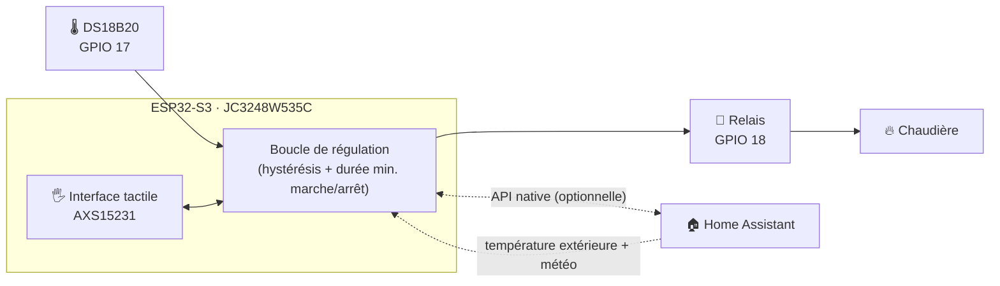

<div align="center">

# 🔥 Thermostat tactile ESP32-S3 et contrôleur de chaudière à gaz

### Thermostat ESPHome autonome et contrôleur de chaudière avec écran tactile de 3,5"

[](https://esphome.io)
[](https://github.com/espressif/esp-idf)
[](https://www.home-assistant.io)
[](https://www.python.org)
[](LICENSE)
[](#️-feuille-de-route)

| [English](./README.md) | [Română](./README.ro.md) | [Magyar](./README.hu.md) | [Polski](./README.pl.md) | [Deutsch](./README.de.md) | [Français](./README.fr.md)

<br>

<div align="center">

[](https://www.youtube.com/watch?v=7YacdU6UZSM)

*Clique sur l'image pour voir une courte démo du thermostat en fonctionnement*

</div>
</div>

---

> [!WARNING]
> **Tension secteur et système de chauffage au gaz. Lis l'[avertissement](#️-avertissement-et-sécurité) avant de construire quoi que ce soit.**

## 📑 Table des matières

- [✨ Fonctionnalités principales](#-fonctionnalités-principales)
- [🏗️ Architecture](#️-architecture)
- [📸 Captures d'écran](#-captures-décran)
- [📱 Guide de l'interface tactile](#-guide-de-linterface-tactile)
- [🧰 Matériel et câblage](#-matériel-et-câblage)
- [🚀 Installation](#-installation)
- [🩺 Dépannage](#-dépannage)
- [🗺️ Feuille de route](#️-feuille-de-route)
- [🤝 Contribuer](#-contribuer)
- [⚠️ Avertissement et sécurité](#️-avertissement-et-sécurité)
- [📄 Licence](#-licence)

---

## ✨ Fonctionnalités principales

| | Fonctionnalité | Détails |
| :-: | :--- | :--- |
| 🧠 | **Boucle de régulation locale** | Lit le DS18B20, évalue l'hystérésis et commande le relais directement depuis l'appareil. Pas de cloud, pas de serveur. |
| 📡 | **Fonctionne hors ligne** | Le Wi-Fi ou Home Assistant sont en panne ? Le thermostat continue de chauffer et peut être entièrement piloté depuis l'écran tactile. |
| 🏠 | **Prêt pour Home Assistant** | API native pour synchroniser la température cible, le mode vacances et les données météo extérieures, ainsi que pour les tableaux de bord. |
| 🖐️ | **Interface tactile complète** | Écran principal + menu des réglages, avec des transitions animées et une flamme animée pendant le chauffage. |
| 🛡️ | **Protection de la chaudière** | Hystérésis et durées minimales de marche/arrêt configurables, pour éviter les cycles courts (short-cycling). |
| 💾 | **Réglages persistants** | Tous les paramètres sont enregistrés dans la mémoire flash et sont conservés après un redémarrage ou une coupure de courant. |
| 🌴 | **Mode vacances** | Une simple pression pour passer à une température économique dédiée. |
| 🔄 | **Mises à jour OTA** | Mets à jour le firmware sans fil, même une fois l'appareil fixé au mur. |

---

## 🏗️ Architecture

Le thermostat repose sur une **conception hybride** : l'ESP32-S3 est le « cerveau », et Home Assistant est une couche supplémentaire optionnelle.



**Autonome (sans Home Assistant)**
- Lecture locale de la température, évaluation de l'hystérésis et commande directe du relais
- Contrôle manuel complet depuis l'écran : température cible, calibrage, hystérésis, mode vacances, luminosité

**Avec Home Assistant (fonctions étendues)**
- Synchronisation des températures cibles et du mode vacances
- Température extérieure et icône d'état de la météo (`weather.forecast_home`)
- Surveillance à distance et automatisations depuis tes propres tableaux de bord

---

## 📸 Captures d'écran

| Écran principal | Menu des réglages |
| :---: | :---: |
|  |  |


---

## 📱 Guide de l'interface tactile

L'interface fonctionne sur un écran IPS capacitif de 3,5" (contrôleur `AXS15231`) et est rendue avec le moteur d'affichage ESPHome.

### Écran principal

| Élément | Description |
| :--- | :--- |
| 🕐 **Heure et date** | Synchronisées via SNTP pour ton fuseau horaire |
| 📶 **Réseau et météo** | Puissance du signal Wi-Fi, plus température extérieure et icône météo (depuis Home Assistant) |
| 🌡️ **Température de la pièce** | Grand affichage de la valeur lue par le DS18B20, avec le décalage de calibrage appliqué |
| 🎯 **Température cible** | La valeur actuellement réglée (ou celle du mode vacances) |
| 🔥 **État du chauffage** | `CHAUFFE` (chauffage actif, avec flamme animée) · `VEILLE` (en attente) · `ARRÊT` (thermostat éteint) |
| ➕➖ **Commandes rapides** | Ajuste la température cible par pas de **0,5 °C** |
| ⚙️ **Réglages** | L'icône d'engrenage (en haut à droite) ouvre le menu des réglages |

### Menu des réglages

Toutes les valeurs sont enregistrées dans la mémoire flash.

| Réglage | Plage / Options |
| :--- | :--- |
| **Unité de mesure** | °C / °F |
| **Calibrage** | −5,0 °C … +5,0 °C |
| **Hystérésis** | 0,1 °C … 2,0 °C |
| **Durée minimale** (marche/arrêt) | 0 … 600 s |
| **Mode vacances** | ACTIVÉ / DÉSACTIVÉ |
| **Temp. vacances** | 5,0 °C … 20,0 °C |
| **Luminosité** | 10 % … 100 % |
| **Affichage de la température extérieure** | Affichée / masquée sur l'écran principal |

---

## 🧰 Matériel et câblage

### Liste des composants

| Composant | Remarques |
| :--- | :--- |
| **JC3248W535C** | Carte ESP32-S3 avec écran IPS tactile capacitif de 3,5" |
| **DS18B20** | Capteur de température 1-Wire |
| **Résistance de 4,7 kΩ** | Pull-up entre DATA et 3,3 V |
| **Module relais** | Dimensionné pour le circuit de commande de ta chaudière |
| **Alimentation 5 V** | Alimentation stable pour la carte |

### Affectation des broches

| Composant | Broche / Interface | Description |
| :--- | :--- | :--- |
| **Écran** | `JC3248W535C` | Écran IPS tactile capacitif de 3,5" (QSPI) |
| **Contrôleur tactile** | `AXS15231` | Interface tactile capacitive intégrée |
| **PWM du rétroéclairage** | `GPIO 1` | Réglage de la luminosité via LEDC |
| **DS18B20** | `GPIO 17` | Ligne de données 1-Wire (nécessite un pull-up de 4,7 kΩ) |
| **Relais de chauffage** | `GPIO 18` | Sortie numérique vers le module relais de la chaudière |
| **Bus I²C** | SDA `GPIO 4` · SCL `GPIO 8` | Capteurs optionnels (par ex. SHT45 / BME280) |
| **Bus SPI (écran)** | CLK `GPIO 47` · Données `[21, 48, 40, 39]` | Quad SPI pour un rendu rapide |

### Branchement du DS18B20

```text
 3,3V ──┬───────────── VCC (DS18B20)
        │
      [4,7kΩ]
        │
 GPIO17 ┴───────────── DATA (DS18B20)

 GND ────────────────── GND (DS18B20)
```

> [!WARNING]
> **DANGER ÉLECTRIQUE : tension secteur de 230 V**
> - Relier le relais au système de chauffage implique de travailler avec la tension secteur.
> - Déconnecte du secteur **à la fois** la chaudière et l'alimentation du thermostat avant de toucher à la moindre connexion.
> - Si tu as le moindre doute ou si tu n'es pas qualifié, **fais appel à un électricien agréé**.

---

## 🚀 Installation

**Environnement testé**

| Outil | Version |
| :--- | :--- |
| Système d'exploitation | Windows, Linux ou macOS (terminal) |
| Python | `3.11.6+` |
| ESPHome | `2025.11.0+` |
| Framework | `ESP-IDF` (configuré automatiquement via `platformio_options` dans le fichier YAML) |

### 1️⃣ Cloner le dépôt

```bash
git clone https://github.com/DaradiciLevente/jc3248w535c-esphome-termostat.git
cd jc3248w535c-esphome-termostat
```

### 2️⃣ Configurer `secrets.yaml`

Crée et mets à jour le fichier `secrets.yaml` dans ton répertoire de configuration ESPHome :

```yaml
wifi_ssid: "Your_WiFi_SSID"
wifi_password: "Your_WiFi_Password"
ap_ssid: "Thermostat-Fallback-AP"
ap_password: "Fallback_Password"
api_password: "Your_ESPHome_API_Password"
ota_password: "Your_OTA_Password"
api_key: "Your_Encryption_Key_Base64"
```

> [!TIP]
> **Génère une clé de chiffrement d'API valide** (32 octets aléatoires, encodés en base64) :
> ```bash
> python -c "import base64, os; print(base64.b64encode(os.urandom(32)).decode())"
> ```

### 3️⃣ Définir les entités Home Assistant

Modifie le bloc `substitutions` au début du fichier YAML :

```yaml
substitutions:
  sensor_temp_exterior: "sensor.your_outdoor_temperature_sensor"
  sensor_stare_vreme: "weather.forecast_your_home"
```

### 4️⃣ Compiler et téléverser le firmware

Branche la carte en USB et lance :

```bash
esphome run termostat-esphome.yaml
```

> [!NOTE]
> Après le premier flashage, une fois l'appareil connecté à ton réseau Wi-Fi, les mises à jour suivantes peuvent se faire **par liaison radio (OTA)**.

---

## 🩺 Dépannage

<details>
<summary><b>🌡️ Le DS18B20 affiche <code>85.0 °C</code> ou <code>--.-</code></b></summary>

<br>

**Cause :** `85.0 °C` est la valeur par défaut de la puce au démarrage et indique un problème de communication ou de câblage.

**Solution :**
- Vérifie le câblage sur `GPIO 17`.
- Assure-toi qu'une **résistance pull-up de 4,7 kΩ** relie la ligne DATA au 3,3 V.
- Vérifie que le capteur reçoit une alimentation stable de 3,3 V.
- Le firmware filtre les valeurs de `85.0 °C` et celles hors plage, mais un câblage correct reste essentiel.

</details>

<details>
<summary><b>🖥️ L'écran reste noir ou le tactile ne répond pas</b></summary>

<br>

**Cause :** définitions de broches incorrectes ou incohérence dans la configuration SPI/écran.

**Solution :**
- Confirme que ta carte est bien exactement la **JC3248W535C** (ESP32-S3, écran QSPI, tactile `AXS15231`).
- Vérifie les broches SPI (`CLK : 47`, Données : `[21, 48, 40, 39]`) et les broches I²C (`SDA : 4`, `SCL : 8`) par rapport à la révision de ton PCB.
- Inspecte les logs série à la recherche de boucles de redémarrage ou d'erreurs de pilote :
  ```bash
  esphome logs termostat-esphome.yaml
  ```

</details>

<details>
<summary><b>📶 La connexion Wi-Fi échoue au démarrage</b></summary>

<br>

**Cause :** identifiants incorrects dans `secrets.yaml` ou signal faible.

**Solution :**
- Revérifie `wifi_ssid` et `wifi_password`.
- Si le réseau principal est injoignable, l'appareil démarre son propre point d'accès de secours (`ap_ssid`). Connecte-toi-y pour consulter les logs ou mettre à jour les identifiants via OTA.

</details>

---

## 🗺️ Feuille de route

Le projet est en développement actif. La documentation et les fonctionnalités évoluent encore.

- [x] Boucle de régulation locale avec hystérésis et durée minimale de marche/arrêt
- [x] Interface tactile avec menu des réglages et flamme animée
- [x] Mode vacances et réglages persistants
- [x] Intégration à Home Assistant (météo + synchronisation)

---

## 🤝 Contribuer

Les contributions, signalements de bugs et demandes de fonctionnalités sont les bienvenus ! Consulte la [page des issues](../../issues).

1. Fais un fork du projet
2. Crée une branche pour ta fonctionnalité : `git checkout -b feature/AmazingFeature`
3. Fais un commit de tes modifications : `git commit -m 'Add some AmazingFeature'`
4. Pousse la branche vers le dépôt : `git push origin feature/AmazingFeature`
5. Ouvre une Pull Request

---

## ⚠️ Avertissement et sécurité

> [!WARNING]
> - Ceci est un **projet DIY réalisé par passion**. Il met en jeu de l'électronique sensible, une **dangereuse tension secteur de 230 V** et des **systèmes de chauffage au gaz**.
> - Il est fourni **uniquement à des fins éducatives et expérimentales**, distribué **« TEL QUEL » (« AS IS »)**, sans aucune garantie, expresse ou implicite.
> - L'auteur ne recommande **pas**, n'approuve pas et ne garantit pas son utilisation dans des installations réelles, de production ou domestiques.
> - L'auteur **n'assume aucune responsabilité juridique ni obligation** pour les dommages directs ou indirects, pertes matérielles, blessures corporelles ou accidents résultant de l'utilisation, du mauvais usage ou de la mise en œuvre de ce projet.
> - En téléchargeant, en clonant ou en utilisant toute partie de ce code ou de cette documentation, tu reconnais être **seul responsable** du respect des réglementations locales en matière de sécurité et d'installations électriques, et tu assumes **100 % du risque et de la responsabilité juridique**.

---

## 📄 Licence

Distribué sous **licence MIT**. Consulte le fichier [`LICENSE`](LICENSE) pour plus de détails.

---

<div align="center">

*Créé avec passion pour les makers, les adeptes du DIY et les passionnés de maison connectée.*

**Réalisé par [Levente Daradici](https://github.com/DaradiciLevente)** 🚀

⭐ Si ce projet t'a été utile, pense à lui donner une étoile !

</div>
