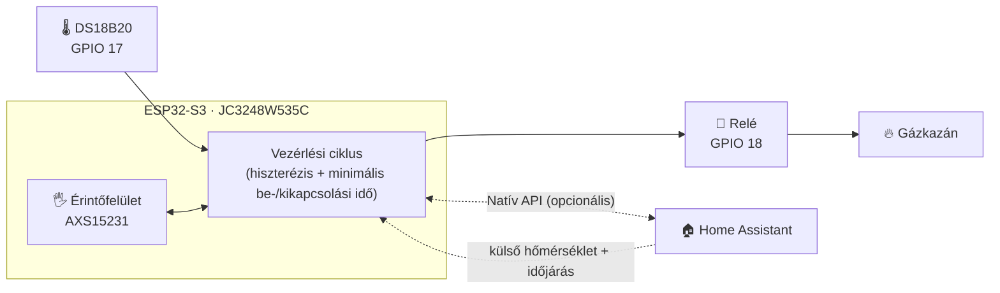
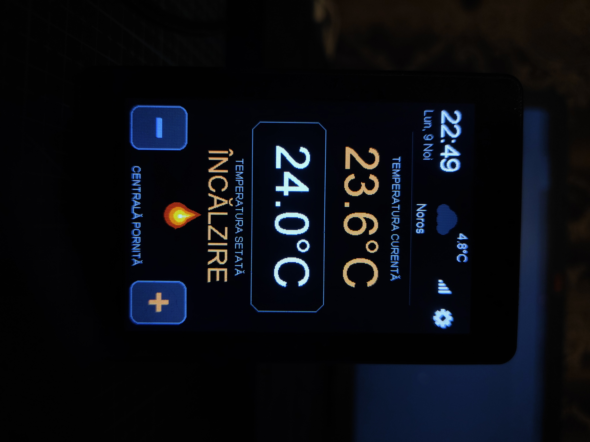
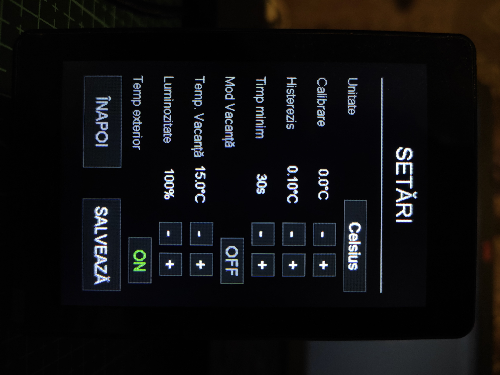

<div align="center">

# 🔥 ESP32-S3 érintőkijelzős termosztát és gázkazán-vezérlő

### Önálló ESPHome termosztát és gázkazán-vezérlő, 3,5"-os érintőkijelzővel

[](https://esphome.io)
[](https://github.com/espressif/esp-idf)
[](https://www.home-assistant.io)
[](https://www.python.org)
[](LICENSE)
[](#️-plan-de-dezvoltare)

| [English](./README.md) | [Română](./README.ro.md) | [Magyar](./README.hu.md) | [Polski](./README.pl.md) | [Deutsch](./README.de.md)

<br>

<div align="center">

[](https://www.youtube.com/watch?v=7YacdU6UZSM)

*Kattints a képre egy rövid bemutatóvideó megtekintéséhez a termosztát működéséről*

</div>
</div>

---

> [!WARNING]
> **Hálózati feszültség és gázfűtési rendszer. A építés megkezdése előtt olvasd el a [felelősségkizárást](#️-felelősségkizárás-és-biztonság).**

## 📑 Tartalomjegyzék

- [✨ Fő funkciók](#-fő-funkciók)
- [🏗️ Architektúra](#️-architektúra)
- [📸 Képernyőképek](#-képernyőképek)
- [📱 Az érintőfelület útmutatója](#-az-érintőfelület-útmutatója)
- [🧰 Hardver és csatlakozások](#-hardver-és-csatlakozások)
- [🚀 Telepítés](#-telepítés)
- [🩺 Hibaelhárítás](#-hibaelhárítás)
- [🗺️ Fejlesztési terv](#️-fejlesztési-terv)
- [🤝 Közreműködés](#-közreműködés)
- [⚠️ Felelősségkizárás és biztonság](#️-felelősségkizárás-és-biztonság)
- [📄 Licenc](#-licenc)
---

## ✨ Fő funkciók

| | Funkció | Részletek |
| :-: | :--- | :--- |
| 🧠 | **Helyi vezérlési ciklus** | Beolvassa a DS18B20-at, kiértékeli a hiszterézist és közvetlenül vezérli a relét az eszközről. Nincs felhő, nincs szerver. |
| 📡 | **Offline működés** | Ha a Wi-Fi vagy a Home Assistant nem elérhető, a termosztát tovább fűt, és teljesen vezérelhető az érintőképernyőről. |
| 🏠 | **Home Assistant-kompatibilis** | Natív API a célhőmérséklet, a nyaralási mód és a külső időjárási adatok szinkronizálásához, valamint dashboardokhoz. |
| 🖐️ | **Teljes érintőfelület** | Főképernyő + beállítási menü, animált átmenetekkel és animált lánggal fűtés közben. |
| 🛡️ | **A kazán védelme** | Konfigurálható hiszterézis és minimális be-/kikapcsolási idők a rövid ciklusok (short-cycling) elkerülésére. |
| 💾 | **Tartós beállítások** | Minden paraméter a flash memóriába mentődik, és újraindítás vagy áramszünet után is megmarad. |
| 🌴 | **Nyaralási mód** | Egyetlen érintéssel átválthatsz egy dedikált takarékos hőmérsékletre. |
| 🔄 | **OTA-frissítések** | A firmware vezeték nélkül frissíthető, miután az eszközt felszerelted a falra. |


---

## 🏗️ Architektúra

A termosztát **hibrid kialakítást** használ: az ESP32-S3 az „agy", a Home Assistant pedig egy opcionális kiegészítő réteg.



**Önálló (Home Assistant nélkül)**
- Helyi hőmérséklet-olvasás, hiszterézis-kiértékelés és a relé közvetlen vezérlése
- Teljes manuális vezérlés a képernyőről: célhőmérséklet, kalibráció, hiszterézis, nyaralási mód, fényerő

**Home Assistanttel (bővített funkciók)**
- A célhőmérséklet és a nyaralási mód szinkronizálása
- Külső hőmérséklet és időjárás-ikon (weather.forecast_home)
- Távoli monitorozás és automatizálások a dashboardjaidból

---

## 📸 Képernyőképek

| Főképernyő | Beállítási menü |
| :---: | :---: |
|  |  |


---

## 📱 Az érintőfelület útmutatója

A felület egy 3,5"-os kapacitív IPS kijelzőn fut (AXS15231 vezérlő), és az ESPHome kijelzőmotorja rendereli.

### Főképernyő

| Elem | Leírás |
| :--- | :--- |
| 🕐 **Óra és dátum** | SNTP-n keresztül szinkronizálva, a te időzónádnak megfelelően |
| 📶 **Hálózat és időjárás** | Wi-Fi jelerősség, valamint a külső hőmérséklet és az időjárás-ikon (a Home Assistantből) |
| 🌡️ **Szobahőmérséklet** | Nagy kijelzés, a DS18B20 által mért értékkel, kalibrációs eltolással |
| 🎯 **Célhőmérséklet** | Az aktuálisan beállított érték (vagy a nyaralási mód értéke) |
| 🔥 **Fűtési állapot** | FŰTÉS (aktív fűtés, animált lánggal) · SZÜNETEL (készenlét) · KIKAPCSOLVA (termosztát kikapcsolva) |
| ➕➖ **Gyorsvezérlők** | A célhőmérséklet 0,5 °C-os lépésekben állítható** |
| ⚙️ **Beállítások** | A fogaskerék ikon (jobb felső sarok) nyitja meg a beállítási menüt |

Beállítási menü

TMinden érték a flash memóriában mentődik.

| Beállítás | Tartomány / Opciók |
| :--- | :--- |
| **Mértékegység** | °C / °F |
| **Kalibráció* | −5,0 °C … +5,0 °C |
| **Hiszterézis** | 0,1 °C … 2,0 °C |
| **Minimális idő** (be/ki) | 0 … 600 s |
| **Nyaralási mód** | BE / KI |
| **Nyaralási hőmérséklet** | 5,0 °C … 20,0 °C |
| **Fényerő** | 10 % … 100 % |
| **Külső hőmérséklet kijelzése** | Megjelenítve / elrejtve a főképernyőn |

---

## 🧰 Hardver és csatlakozások

### Alkatrészlista

| Alkatrész | Megjegyzés |
| :--- | :--- |
| **JC3248W535C** | ESP32-S3 kártya 3,5"-os kapacitív érintős IPS kijelzővel |
| **DS18B20** | 1-Wire hőmérséklet-érzékelő |
| **4,7 kΩ-os ellenállás** | Pull-up a DATA és a 3,3 V között|
| **Relé modul** | A kazánod vezérlőáramköréhez méretezve |
| **5 V-os tápegység** | Stabil tápellátás a kártyához |

### Csatlakozókiosztás

| Alkatrész| Csatlakozó / Interfész | Leírás |
| :--- | :--- | :--- |
| **Kijelző** | `JC3248W535C` | 3,5"-os kapacitív érintős IPS kijelző (QSPI) |
| **Érintővezérlő** | `AXS15231` | Integrált kapacitív érintőfelület |
| **Háttérvilágítás PWM** | `GPIO 1` | Fényerő vezérlése LEDC-n keresztül |
| **DS18B20** | `GPIO 17` | 1-Wire adatvonal (4,7 kΩ-os pull-up szükséges) |
| **Fűtés relé** | `GPIO 18` | Digitális kimenet a kazán relé modulja felé |
| **I²C busz | SDA `GPIO 4` · SCL `GPIO 8` | Opcionális érzékelők (pl. SHT45 / BME280) |
| **SPI busz (kijelző)** | CLK `GPIO 47` · Adat `[21, 48, 40, 39]` | Quad SPI a gyors rendereléshez |

### A DS18B20 csatlakoztatása

```text
 3,3V ──┬───────────── VCC (DS18B20)
        │
      [4,7kΩ]
        │
 GPIO17 ┴───────────── DATA (DS18B20)

 GND ────────────────── GND (DS18B20)
```

> [!WARNING]
> **ELEKTROMOS VESZÉLY: 230 V-os hálózati feszültség**
> - A relé fűtési rendszerhez való csatlakoztatása hálózati feszültséggel való munkát jelent.
> - Bármilyen csatlakozás megérintése előtt mind a kazánt, mind a termosztát tápegységét válaszd le a hálózatról.
> - Ha nem vagy biztos a dolgodban, vagy nem vagy képzett, fordulj szakképzett villanyszerelőhöz.**.

---

## 🚀 Telepítés

**Tesztelt környezet**

| Eszköz | Verzió |
| :--- | :--- |
| Operációs rendszer | Windows, Linux vagy macOS (terminál) |
| Python | `3.11.6+` |
| ESPHome | `2025.11.0+` |
| Framework | `ESP-IDF` (automatikusan konfigurálva a `platformio_options` révén a YAML fájlban) |

### 1️⃣ Klónozd a repository-t

```bash
git clone https://github.com/DaradiciLevente/jc3248w535c-esphome-termostat.git
cd jc3248w535c-esphome-termostat
```

### 2️⃣ Konfiguráld a `secrets.yaml` fájlt

Hozd létre vagy frissítsd a secrets.yaml fájlt az ESPHome konfigurációs könyvtáradban:

```yaml
wifi_ssid: "Your_WiFi_SSID"
wifi_password: "Your_WiFi_Password"
ap_ssid: "Thermostat-Fallback-AP"
ap_password: "Fallback_Password"
api_password: "Your_ESPHome_API_Password"
ota_password: "Your_OTA_Password"
api_key: "Your_Encryption_Key_Base64"
```

> [!TIP]
> **Generálj egy érvényes API titkosítási kulcsot (32 véletlenszerű bájt, base64-ben kódolva):
> ```bash
> python -c "import base64, os; print(base64.b64encode(os.urandom(32)).decode())"
> ```

### 3️⃣ Állítsd be a Home Assistant entitásokat

Szerkeszd a YAML fájl elején található `substitutions` blokkot:

```yaml
substitutions:
  sensor_temp_exterior: "sensor.your_outdoor_temperature_sensor"
  sensor_stare_vreme: "weather.forecast_your_home"
```

### 4️⃣ Fordítás és firmware feltöltés

Csatlakoztasd a kártyát USB-n keresztül, és futtasd:

```bash
esphome run termostat-esphome.yaml
```

> [!NOTE]
> Az első feltöltés után, amint az eszköz csatlakozott a Wi-Fi hálózatodhoz, a további frissítések vezeték nélkül (OTA) végezhetők.**.

---

## 🩺 Hibaelhárítás

<details>
<summary><b>🌡️ A DS18B20 <code>85.0 °C</code> vagy <code>--.-</code>-t mutat</b></summary>

<br>

**Ok: A ** `85.0 °C` a chip alapértelmezett értéke bekapcsoláskor, és kommunikációs vagy bekötési problémára utal.

**Megoldás::**
- Ellenőrizd a bekötést a `GPIO 17`-en..
- Győződj meg róla, hogy egy 4,7 kΩ-os pull-up ellenállás köti össze a DATA vonalat a 3,3 V-tal.
- Ellenőrizd, hogy az érzékelő stabil 3,3 V-os tápot kap.
- A firmware kiszűri a `85.0 °C`-os és a tartományon kívüli értékeket, de a helyes bekötés elengedhetetlen.

</details>

<details>
<summary><b>🖥️ A képernyő fekete marad, vagy az érintés nem válaszol</b></summary>

<br>

**Ok:** Hibás csatlakozó-definíciók vagy az SPI/kijelző konfiguráció eltérése..

**Megoldás:**
- Erősítsd meg, hogy a kártyád pontosan **JC3248W535C** (ESP32-S3, QSPI kijelző, `AXS15231` touch).
- Ellenőrizd az SPI lábakat (`CLK: 47`, Adat: `[21, 48, 40, 39]`) és az I²C lábakat (`SDA: 4`, `SCL: 8`) a PCB revíziódhoz képest.
- Vizsgáld meg a soros naplókat újraindítási ciklusok vagy illesztőprogram-hibák után:
  ```bash
  esphome logs termostat-esphome.yaml
  ```

</details>

<details>
<summary><b>📶 A Wi-Fi csatlakozás meghiúsul bekapcsoláskor</b></summary>

<br>

**Ok:** Hibás hitelesítő adatok a `secrets.yaml`-ban, vagy gyenge jel.

**Megoldás:**
- Ellenőrizd újra a `wifi_ssid` és `wifi_password` értékeket..
- Ha a fő hálózat nem érhető el, az eszköz elindítja a saját tartalék hozzáférési pontját (`ap_ssid`). Csatlakozz hozzá a naplók ellenőrzéséhez vagy a hitelesítő adatok OTA-n keresztüli frissítéséhez.

</details>

---

## 🗺️ Fejlesztési terv

A projekt aktív fejlesztés alatt áll. A dokumentáció és a funkciók még fejlődnek.

- [x] Helyi vezérlési ciklus hiszterézissel és minimális be-/kikapcsolási idővel
- [x] Érintőfelület beállítási menüvel és animált lánggal
- [x] Nyaralási mód és tartós beállítások
- [x] Home Assistant integráció (időjárás + szinkronizálás)

---

## 🤝 Közreműködés

A közreműködések, hibajelentések és funkciókérések szívesen fogadottak! Nézd meg az [issues oldalt](../../issues).

1. Forkold a projektet
2. Hozz létre egy ágat a funkciódhoz: `git checkout -b feature/AmazingFeature`
3. Commitold a módosításokat: `git commit -m 'Add some AmazingFeature'`
4. Küldd fel az ágat a repository-ba: `git push origin feature/AmazingFeature`
5. Nyiss egy Pull Requestet

---

## ⚠️ Felelősségkizárás és biztonság

> [!WARNING]
> - Ez egy hobbi DIY-projekt. Érzékeny elektronikát, **veszélyes 230 V-os hálózati feszültséget** és **gázfűtési rendszereket érint**.
> - **Kizárólag oktatási és kísérleti célra**, kínáljuk, **„AHOGY VAN” („AS IS”)** módon, semmilyen kifejezett vagy hallgatólagos garancia nélkül.
> - A szerző **nem** javasolja, **nem támogatja** és **nem garantálja** valós, termelési vagy háztartási rendszerekben való használatát.
> - A szerző **semmilyen jogi felelősséget vagy kötelezettséget nem vállal** a projekt használatából, helytelen használatából vagy megvalósításából eredő közvetlen vagy közvetett károkért, anyagi veszteségekért, személyi sérülésekért vagy balesetekért.
> - A kód vagy a dokumentáció bármely részének letöltésével, klónozásával vagy használatával elismered, hogy egyedül te vagy felelős a helyi biztonsági és elektromos előírások betartásáért, és **100%-ban magadra vállalod a kockázatot és a jogi felelősséget**.

---

## 📄 Licenc

Az MIT licenc alatt terjesztve. A részletekért lásd a [`LICENSE`](LICENSE) fájlt.

---

<div align="center">

*Szenvedéllyel készült makereknek, DIY-rajongóknak és okosotthon-rajongóknak.*

**Készítette: [Levente Daradici](https://github.com/DaradiciLevente)** 🚀

⭐ Ha ez a projekt hasznos volt számodra, fontold meg, hogy adsz neki egy csillagot!

</div>
