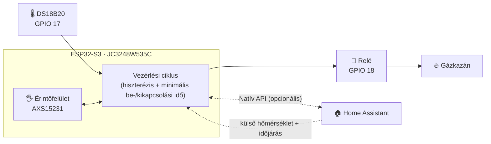

<div align="center">

# 🔥 ESP32-S3 érintőkijelzős termosztát és gázkazán-vezérlő

### Önálló ESPHome termosztát és gázkazán-vezérlő, 3,5"-os érintőkijelzővel

[](https://esphome.io)
[](https://github.com/espressif/esp-idf)
[](https://www.home-assistant.io)
[](https://www.python.org)
[](LICENSE)
[](#️-plan-de-dezvoltare)

| [English](./README.md) | [Română](./README.ro.md) | [Magyar](./README.hu.md)

<br>

<div align="center">

[](https://www.youtube.com/watch?v=7YacdU6UZSM)

*Kattints a képre egy rövid bemutatóvideó megtekintéséhez a termosztát működéséről*

</div>
</div>

---

> [!WARNING]
> **Hálózati feszültség és gázfűtési rendszer. A építés megkezdése előtt olvasd el a [felelősségkizárást](#️-felelősségkizárás-és-biztonság).**

## 📑 Tartalomjegyzék

- [✨ Fő funkciók](#-fő-funkciók)
- [🏗️ Architektúra](#️-architektúra)
- [📸 Képernyőképek](#-képernyőképek)
- [📱 Az érintőfelület útmutatója](#-az-érintőfelület-útmutatója)
- [🧰 Hardver és csatlakozások](#-hardver-és-csatlakozások)
- [🚀 Telepítés](#-telepítés)
- [🩺 Hibaelhárítás](#-hibaelhárítás)
- [🗺️ Fejlesztési terv](#️-fejlesztési-terv)
- [🤝 Közreműködés](#-közreműködés)
- [⚠️ Felelősségkizárás és biztonság](#️-felelősségkizárás-és-biztonság)
- [📄 Licenc](#-licenc)
---

## ✨ Fő funkciók

| | Funkció | Részletek |
| :-: | :--- | :--- |
| 🧠 | **Helyi vezérlési ciklus** | Beolvassa a DS18B20-at, kiértékeli a hiszterézist és közvetlenül vezérli a relét az eszközről. Nincs felhő, nincs szerver. |
| 📡 | **Offline működés** | Ha a Wi-Fi vagy a Home Assistant nem elérhető, a termosztát tovább fűt, és teljesen vezérelhető az érintőképernyőről. |
| 🏠 | **Home Assistant-kompatibilis** | Natív API a célhőmérséklet, a nyaralási mód és a külső időjárási adatok szinkronizálásához, valamint dashboardokhoz. |
| 🖐️ | **Teljes érintőfelület** | Főképernyő + beállítási menü, animált átmenetekkel és animált lánggal fűtés közben. |
| 🛡️ | **A kazán védelme** | Konfigurálható hiszterézis és minimális be-/kikapcsolási idők a rövid ciklusok (short-cycling) elkerülésére. |
| 💾 | **Tartós beállítások** | Minden paraméter a flash memóriába mentődik, és újraindítás vagy áramszünet után is megmarad. |
| 🌴 | **Nyaralási mód** | Egyetlen érintéssel átválthatsz egy dedikált takarékos hőmérsékletre. |
| 🔄 | **OTA-frissítések** | A firmware vezeték nélkül frissíthető, miután az eszközt felszerelted a falra. |


---

## 🏗️ Architektúra

A termosztát **hibrid kialakítást** használ: az ESP32-S3 az „agy", a Home Assistant pedig egy opcionális kiegészítő réteg.



**Önálló (Home Assistant nélkül)**
- Helyi hőmérséklet-olvasás, hiszterézis-kiértékelés és a relé közvetlen vezérlése
- Teljes manuális vezérlés a képernyőről: célhőmérséklet, kalibráció, hiszterézis, nyaralási mód, fényerő

**Home Assistanttel (bővített funkciók)**
- A célhőmérséklet és a nyaralási mód szinkronizálása
- Külső hőmérséklet és időjárás-ikon (weather.forecast_home)
- Távoli monitorozás és automatizálások a dashboardjaidból

---

## 📸 Képernyőképek

| Főképernyő | Beállítási menü |
| :---: | :---: |
|  |  |


---

## 📱 Az érintőfelület útmutatója

A felület egy 3,5"-os kapacitív IPS kijelzőn fut (AXS15231 vezérlő), és az ESPHome kijelzőmotorja rendereli.

### Főképernyő

| Elem | Leírás |
| :--- | :--- |
| 🕐 **Óra és dátum** | SNTP-n keresztül szinkronizálva, a te időzónádnak megfelelően |
| 📶 **Hálózat és időjárás** | Wi-Fi jelerősség, valamint a külső hőmérséklet és az időjárás-ikon (a Home Assistantből) |
| 🌡️ **Szobahőmérséklet** | Nagy kijelzés, a DS18B20 által mért értékkel, kalibrációs eltolással |
| 🎯 **Célhőmérséklet** | Az aktuálisan beállított érték (vagy a nyaralási mód értéke) |
| 🔥 **Fűtési állapot** | FŰTÉS (aktív fűtés, animált lánggal) · SZÜNETEL (készenlét) · KIKAPCSOLVA (termosztát kikapcsolva) |
| ➕➖ **Gyorsvezérlők** | A célhőmérséklet 0,5 °C-os lépésekben állítható** |
| ⚙️ **Beállítások** | A fogaskerék ikon (jobb felső sarok) nyitja meg a beállítási menüt |

Beállítási menü

TMinden érték a flash memóriában mentődik.

| Beállítás | Tartomány / Opciók |
| :--- | :--- |
| **Mértékegység** | °C / °F |
| **Kalibráció* | −5,0 °C … +5,0 °C |
| **Hiszterézis** | 0,1 °C … 2,0 °C |
| **Minimális idő** (be/ki) | 0 … 600 s |
| **Nyaralási mód** | BE / KI |
| **Nyaralási hőmérséklet** | 5,0 °C … 20,0 °C |
| **Fényerő** | 10 % … 100 % |
| **Külső hőmérséklet kijelzése** | Megjelenítve / elrejtve a főképernyőn |

---

## 🧰 Hardver és csatlakozások

### Alkatrészlista

| Alkatrész | Megjegyzés |
| :--- | :--- |
| **JC3248W535C** | ESP32-S3 kártya 3,5"-os kapacitív érintős IPS kijelzővel |
| **DS18B20** | 1-Wire hőmérséklet-érzékelő |
| **4,7 kΩ-os ellenállás** | Pull-up a DATA és a 3,3 V között|
| **Relé modul** | A kazánod vezérlőáramköréhez méretezve |
| **5 V-os tápegység** | Stabil tápellátás a kártyához |

### Csatlakozókiosztás

| Alkatrész| Csatlakozó / Interfész | Leírás |
| :--- | :--- | :--- |
| **Kijelző** | `JC3248W535C` | 3,5"-os kapacitív érintős IPS kijelző (QSPI) |
| **Érintővezérlő** | `AXS15231` | Integrált kapacitív érintőfelület |
| **Háttérvilágítás PWM** | `GPIO 1` | Fényerő vezérlése LEDC-n keresztül |
| **DS18B20** | `GPIO 17` | 1-Wire adatvonal (4,7 kΩ-os pull-up szükséges) |
| **Fűtés relé** | `GPIO 18` | Digitális kimenet a kazán relé modulja felé |
| **I²C busz | SDA `GPIO 4` · SCL `GPIO 8` | Opcionális érzékelők (pl. SHT45 / BME280) |
| **SPI busz (kijelző)** | CLK `GPIO 47` · Adat `[21, 48, 40, 39]` | Quad SPI a gyors rendereléshez |

### Conectarea DS18B20

```text
 3,3V ──┬───────────── VCC (DS18B20)
        │
      [4,7kΩ]
        │
 GPIO17 ┴───────────── DATA (DS18B20)

 GND ────────────────── GND (DS18B20)
```

> [!WARNING]
> **PERICOL ELECTRIC: tensiune de rețea de 230 V**
> - Conectarea releului la sistemul de încălzire implică lucrul cu tensiune de rețea.
> - Deconectează de la rețea **atât** centrala, cât și sursa de alimentare a termostatului, înainte de a atinge orice conexiune.
> - Dacă nu ești sigur sau nu ești calificat, **apelează la un electrician autorizat**.

---

## 🚀 Instalare

**Mediul testat**

| Instrument | Versiune |
| :--- | :--- |
| Sistem de operare | Windows, Linux sau macOS (terminal) |
| Python | `3.11.6+` |
| ESPHome | `2025.11.0+` |
| Framework | `ESP-IDF` (configurat automat prin `platformio_options` în fișierul YAML) |

### 1️⃣ Clonează repository-ul

```bash
git clone https://github.com/DaradiciLevente/jc3248w535c-esphome-termostat.git
cd jc3248w535c-esphome-termostat
```

### 2️⃣ Configurează `secrets.yaml`

Creează și actualizează fișierul `secrets.yaml` în directorul tău de configurare ESPHome:

```yaml
wifi_ssid: "Your_WiFi_SSID"
wifi_password: "Your_WiFi_Password"
ap_ssid: "Thermostat-Fallback-AP"
ap_password: "Fallback_Password"
api_password: "Your_ESPHome_API_Password"
ota_password: "Your_OTA_Password"
api_key: "Your_Encryption_Key_Base64"
```

> [!TIP]
> **Generează o cheie de criptare API validă** (32 de octeți aleatori, codați în base64):
> ```bash
> python -c "import base64, os; print(base64.b64encode(os.urandom(32)).decode())"
> ```

### 3️⃣ Setează entitățile din Home Assistant

Editează blocul `substitutions` de la începutul fișierului YAML:

```yaml
substitutions:
  sensor_temp_exterior: "sensor.your_outdoor_temperature_sensor"
  sensor_stare_vreme: "weather.forecast_your_home"
```

### 4️⃣ Compilează și încarcă firmware-ul

Conectează placa prin USB și rulează:

```bash
esphome run termostat-esphome.yaml
```

> [!NOTE]
> După primul flash, odată ce dispozitivul este conectat de rețeaua ta WiFi, actualizările ulterioare se pot face **prin aer (OTA)**.

---

## 🩺 Depanare

<details>
<summary><b>🌡️ DS18B20 afișează <code>85.0 °C</code> sau <code>--.-</code></b></summary>

<br>

**Cauză:** `85.0 °C` este valoarea implicită a cipului la pornire și indică o problemă de comunicație sau de cablare.

**Soluție:**
- Verifică cablarea pe `GPIO 17`.
- Asigură-te că un **rezistor pull-up de 4,7 kΩ** leagă linia DATA de 3,3 V.
- Verifică dacă senzorul primește o alimentare stabilă de 3,3 V.
- Firmware-ul filtrează valorile de `85.0 °C` și pe cele din afara intervalului, dar o cablare corectă rămâne esențială.

</details>

<details>
<summary><b>🖥️ Ecranul rămâne negru sau atingerea nu răspunde</b></summary>

<br>

**Cauză:** definiții greșite ale pinilor sau o nepotrivire în configurația SPI/ecran.

**Soluție:**
- Confirmă că placa ta este exact **JC3248W535C** (ESP32-S3, ecran QSPI, touch `AXS15231`).
- Verifică pinii SPI (`CLK: 47`, Date: `[21, 48, 40, 39]`) și pinii I²C (`SDA: 4`, `SCL: 8`) față de revizia PCB-ului tău.
- Inspectează logurile seriale pentru bucle de repornire sau erori de driver:
  ```bash
  esphome logs termostat-esphome.yaml
  ```

</details>

<details>
<summary><b>📶 Conectarea la Wi-Fi eșuează la pornire</b></summary>

<br>

**Cauză:** credențiale greșite în `secrets.yaml` sau semnal slab.

**Soluție:**
- Verifică din nou `wifi_ssid` și `wifi_password`.
- Dacă rețeaua principală nu poate fi atinsă, dispozitivul pornește propriul punct de acces de rezervă (`ap_ssid`). Conectează-te la el pentru a verifica logurile sau pentru a actualiza credențialele prin OTA.

</details>

---

## 🗺️ Plan de dezvoltare

Proiectul este în dezvoltare activă. Documentația și funcționalitățile sunt încă în evoluție.

- [x] Buclă de control locală cu histerezis și timp minim pornit/oprit
- [x] Interfață tactilă cu meniu de setări și flacără animată
- [x] Mod vacanță și setări persistente
- [x] Integrare cu Home Assistant (vreme + sincronizare)

---

## 🤝 Contribuții

Contribuțiile, raportările de probleme și cererile de funcționalități sunt binevenite! Consultă [pagina de issues](../../issues).

1. Fă un fork al proiectului
2. Creează o ramură pentru funcționalitatea ta: `git checkout -b feature/AmazingFeature`
3. Fă commit modificărilor: `git commit -m 'Add some AmazingFeature'`
4. Trimite ramura în repository: `git push origin feature/AmazingFeature`
5. Deschide un Pull Request

---

## ⚠️ Declinarea responsabilității și siguranță

> [!WARNING]
> - Acesta este un **proiect DIY, realizat ca hobby**. Implică electronică sensibilă, **tensiune de rețea periculoasă de 230 V** și **sisteme de încălzire pe gaz**.
> - Este oferit **exclusiv în scop educativ și experimental**, distribuit **„CA ATARE” („AS IS”)**, fără niciun fel de garanție, expresă sau implicită.
> - Autorul **nu** recomandă, nu susține și nu garantează utilizarea lui în instalații reale, de producție sau casnice.
> - Autorul **nu își asumă nicio răspundere legală sau obligație** pentru daune directe sau indirecte, pierderi materiale, vătămări corporale sau accidente rezultate din utilizarea, folosirea necorespunzătoare sau implementarea acestui proiect.
> - Prin descărcarea, clonarea sau utilizarea oricărei părți din acest cod sau din această documentație, recunoști că ești **singurul responsabil** pentru respectarea reglementărilor locale privind siguranța și instalațiile electrice și îți asumi **100% din risc și din răspunderea legală**.

---

## 📄 Licență

Distribuit sub **Licența MIT**. Consultă fișierul [`LICENSE`](LICENSE) pentru detalii.

---

<div align="center">

*Creat cu pasiune pentru makeri, pasionați de DIY și entuziaști ai casei inteligente.*

**Realizat de [Levente Daradici](https://github.com/DaradiciLevente)** 🚀

⭐ Dacă acest proiect ți-a fost de folos, gândește-te să-i dai o stea!

</div>
