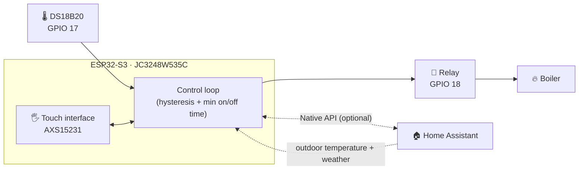

<div align="center">

# 🔥 ESP32-S3 Touchscreen Thermostat & Gas Boiler Controller

### Standalone ESPHome thermostat and boiler controller with a 3.5" touchscreen

[](https://esphome.io)
[](https://github.com/espressif/esp-idf)
[](https://www.home-assistant.io)
[](https://www.python.org)
[](LICENSE)
[](#️-roadmap)

| [English](./README.md) | [Română](./README.ro.md) | [Magyar](./README.hu.md) | [Polski](./README.pl.md) | [Deutsch](./README.de.md) | [Français](./README.fr.md)

<br>

<div align="center">

[](https://www.youtube.com/watch?v=7YacdU6UZSM)

*Click the image to watch a short demo of the thermostat in action*

</div>
</div>

---

> [!WARNING]
> **Mains voltage and gas heating system. Read the [disclaimer](#️-disclaimer-and-safety) before building anything.**

## 📑 Table of Contents

- [✨ Key Features](#-key-features)
- [🏗️ Architecture](#️-architecture)
- [📸 Screenshots](#-screenshots)
- [📱 Touch Interface Guide](#-touch-interface-guide)
- [🧰 Hardware & Wiring](#-hardware--wiring)
- [🚀 Installation](#-installation)
- [🩺 Troubleshooting](#-troubleshooting)
- [🗺️ Roadmap](#️-roadmap)
- [🤝 Contributing](#-contributing)
- [⚠️ Disclaimer & Safety](#️-disclaimer--safety)
- [📄 License](#-license)

---

## ✨ Key Features

| | Feature | Details |
| :-: | :--- | :--- |
| 🧠 | **Local control loop** | Reads the DS18B20, evaluates the hysteresis and drives the relay directly from the device. No cloud, no server. |
| 📡 | **Works offline** | Wi-Fi or Home Assistant down? The thermostat keeps heating and can be fully controlled from the touchscreen. |
| 🏠 | **Home Assistant ready** | Native API for syncing the target temperature, vacation mode and outdoor weather data, and for dashboards. |
| 🖐️ | **Full touch interface** | Main screen + settings menu, with animated transitions and an animated flame while heating. |
| 🛡️ | **Boiler protection** | Configurable hysteresis and minimum on/off times to prevent short-cycling. |
| 💾 | **Persistent settings** | All parameters are stored in flash memory and survive reboots and power outages. |
| 🌴 | **Vacation mode** | One tap to switch to a dedicated economy temperature. |
| 🔄 | **OTA updates** | Update the firmware wirelessly, even after the device is mounted on the wall. |

---

## 🏗️ Architecture

The thermostat uses a **hybrid design**: the ESP32-S3 is the "brain", and Home Assistant is an optional extra layer.



**Standalone (without Home Assistant)**
- Local temperature reading, hysteresis evaluation and direct relay control
- Full manual control from the screen: target temperature, calibration, hysteresis, vacation mode, brightness

**With Home Assistant (extended features)**
- Synchronization of target temperatures and vacation mode
- Outdoor temperature and weather condition icon (`weather.forecast_home`)
- Remote monitoring and automations from your own dashboards

---

## 📸 Screenshots

| Main screen | Settings menu |
| :---: | :---: |
|  |  |


---

## 📱 Touch Interface Guide

The interface runs on a 3.5" capacitive IPS display (`AXS15231` controller) and is rendered with the ESPHome display engine.

### Main screen

| Element | Description |
| :--- | :--- |
| 🕐 **Clock & date** | Synchronized via SNTP for your time zone |
| 📶 **Network & weather** | Wi-Fi signal strength, plus outdoor temperature and weather icon (from Home Assistant) |
| 🌡️ **Room temperature** | Large display of the value read by the DS18B20, with calibration offset applied |
| 🎯 **Target temperature** | The currently set value (or the vacation-mode value) |
| 🔥 **Heating status** | `HEATING` (actively heating, with animated flame) · `IDLE` (standing by) · `OFF` (thermostat off) |
| ➕➖ **Quick controls** | Adjust the target temperature in steps of **0.5 °C** |
| ⚙️ **Settings** | The gear icon (top right) opens the settings menu |

### Settings menu

All values are saved to flash memory.

| Setting | Range / Options |
| :--- | :--- |
| **Unit of measurement** | °C / °F |
| **Calibration** | −5.0 °C … +5.0 °C |
| **Hysteresis** | 0.1 °C … 2.0 °C |
| **Minimum time** (on/off) | 0 … 600 s |
| **Vacation Mode** | ON / OFF |
| **Vacation Temp.** | 5.0 °C … 20.0 °C |
| **Brightness** | 10 % … 100 % |
| **Outdoor temperature display** | Shown / hidden on the main screen |

---

## 🧰 Hardware & Wiring

### Bill of materials

| Component | Notes |
| :--- | :--- |
| **JC3248W535C** | ESP32-S3 board with a 3.5" capacitive touch IPS display |
| **DS18B20** | 1-Wire temperature sensor |
| **4.7 kΩ resistor** | Pull-up between DATA and 3.3 V |
| **Relay module** | Rated for your boiler's control circuit |
| **5 V power supply** | Stable power for the board |

### Pin assignment

| Component | Pin / Interface | Description |
| :--- | :--- | :--- |
| **Display** | `JC3248W535C` | 3.5" capacitive touch IPS display (QSPI) |
| **Touch controller** | `AXS15231` | Integrated capacitive touch interface |
| **Backlight PWM** | `GPIO 1` | Brightness control via LEDC |
| **DS18B20** | `GPIO 17` | 1-Wire data line (requires a 4.7 kΩ pull-up) |
| **Heating relay** | `GPIO 18` | Digital output to the boiler's relay module |
| **I²C bus** | SDA `GPIO 4` · SCL `GPIO 8` | Optional sensors (e.g. SHT45 / BME280) |
| **SPI bus (display)** | CLK `GPIO 47` · Data `[21, 48, 40, 39]` | Quad SPI for fast rendering |

### Wiring the DS18B20

```text
 3.3V ──┬───────────── VCC (DS18B20)
        │
      [4.7kΩ]
        │
 GPIO17 ┴───────────── DATA (DS18B20)

 GND ────────────────── GND (DS18B20)
```

> [!WARNING]
> **ELECTRICAL HAZARD: 230 V mains voltage**
> - Connecting the relay to the heating system involves working with mains voltage.
> - Disconnect **both** the boiler and the thermostat's power supply from the mains before touching any connection.
> - If you are unsure or not qualified, **hire a licensed electrician**.

---

## 🚀 Installation

**Tested environment**

| Tool | Version |
| :--- | :--- |
| Operating system | Windows, Linux or macOS (terminal) |
| Python | `3.11.6+` |
| ESPHome | `2025.11.0+` |
| Framework | `ESP-IDF` (configured automatically through `platformio_options` in the YAML file) |

### 1️⃣ Clone the repository

```bash
git clone https://github.com/DaradiciLevente/jc3248w535c-esphome-termostat.git
cd jc3248w535c-esphome-termostat
```

### 2️⃣ Configure `secrets.yaml`

Create and update the `secrets.yaml` file in your ESPHome configuration directory:

```yaml
wifi_ssid: "Your_WiFi_SSID"
wifi_password: "Your_WiFi_Password"
ap_ssid: "Thermostat-Fallback-AP"
ap_password: "Fallback_Password"
api_password: "Your_ESPHome_API_Password"
ota_password: "Your_OTA_Password"
api_key: "Your_Encryption_Key_Base64"
```

> [!TIP]
> **Generate a valid API encryption key** (32 random bytes, base64-encoded):
> ```bash
> python -c "import base64, os; print(base64.b64encode(os.urandom(32)).decode())"
> ```

### 3️⃣ Set your Home Assistant entities

Edit the `substitutions` block at the top of the YAML file:

```yaml
substitutions:
  sensor_temp_exterior: "sensor.your_outdoor_temperature_sensor"
  sensor_stare_vreme: "weather.forecast_your_home"
```

### 4️⃣ Compile and upload the firmware

Connect the board via USB and run:

```bash
esphome run termostat-esphome.yaml
```

> [!NOTE]
> After the first flash, once the device is connected to your Wi-Fi network, subsequent updates can be done **over the air (OTA)**.

---

## 🩺 Troubleshooting

<details>
<summary><b>🌡️ DS18B20 shows <code>85.0 °C</code> or <code>--.-</code></b></summary>

<br>

**Cause:** `85.0 °C` is the chip's default power-on value and indicates a communication or wiring problem.

**Solution:**
- Check the wiring on `GPIO 17`.
- Make sure a **4.7 kΩ pull-up resistor** connects the DATA line to 3.3 V.
- Verify that the sensor receives a stable 3.3 V supply.
- The firmware filters out `85.0 °C` and out-of-range values, but correct wiring is still essential.

</details>

<details>
<summary><b>🖥️ The screen stays black or touch does not respond</b></summary>

<br>

**Cause:** wrong pin definitions or a mismatch in the SPI/display configuration.

**Solution:**
- Confirm that your board is exactly the **JC3248W535C** (ESP32-S3, QSPI display, `AXS15231` touch).
- Check the SPI pins (`CLK: 47`, Data: `[21, 48, 40, 39]`) and the I²C pins (`SDA: 4`, `SCL: 8`) against your PCB revision.
- Inspect the serial logs for boot loops or driver errors:
  ```bash
  esphome logs termostat-esphome.yaml
  ```

</details>

<details>
<summary><b>📶 Wi-Fi connection fails at startup</b></summary>

<br>

**Cause:** wrong credentials in `secrets.yaml` or a weak signal.

**Solution:**
- Double-check `wifi_ssid` and `wifi_password`.
- If the main network cannot be reached, the device starts its own fallback access point (`ap_ssid`). Connect to it to check the logs or to update the credentials via OTA.

</details>

---

## 🗺️ Roadmap

The project is under active development. Documentation and features are still evolving.

- [x] Local control loop with hysteresis and minimum on/off time
- [x] Touch interface with settings menu and animated flame
- [x] Vacation mode and persistent settings
- [x] Home Assistant integration (weather + sync)

---

## 🤝 Contributing

Contributions, bug reports and feature requests are welcome! Check the [issues page](../../issues).

1. Fork the project
2. Create your feature branch: `git checkout -b feature/AmazingFeature`
3. Commit your changes: `git commit -m 'Add some AmazingFeature'`
4. Push the branch to the repository: `git push origin feature/AmazingFeature`
5. Open a Pull Request

---

## ⚠️ Disclaimer & Safety

> [!WARNING]
> - This is a **DIY hobby project**. It involves sensitive electronics, **dangerous 230 V mains voltage** and **gas heating systems**.
> - It is provided **for educational and experimental purposes only**, distributed **"AS IS"**, without warranty of any kind, express or implied.
> - The author does **not** recommend, endorse or guarantee its use in real, production or household installations.
> - The author **assumes no legal liability or obligation** for direct or indirect damages, property loss, personal injury or accidents resulting from the use, misuse or implementation of this project.
> - By downloading, cloning or using any part of this code or documentation, you acknowledge that you are **solely responsible** for complying with local safety and electrical regulations and that you assume **100% of the risk and legal liability**.

---

## 📄 License

Distributed under the **MIT License**. See the [`LICENSE`](LICENSE) file for details.

---

<div align="center">

*Made with passion for makers, DIY enthusiasts and smart-home fans.*

**Created by [Levente Daradici](https://github.com/DaradiciLevente)** 🚀

⭐ If this project was useful to you, consider giving it a star!

</div>
