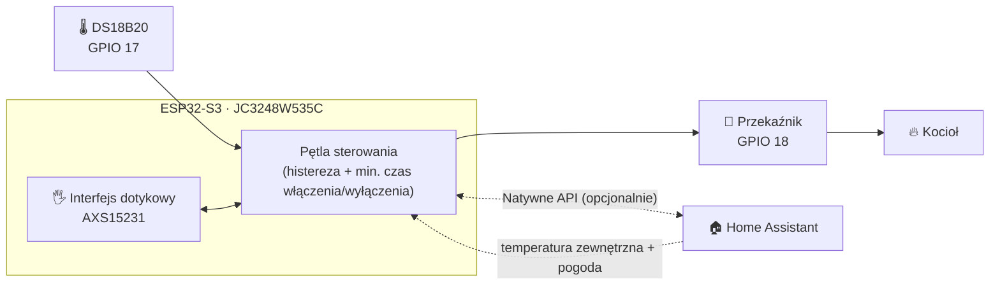

<div align="center">

# 🔥 Dotykowy termostat ESP32-S3 i sterownik kotła gazowego

### Autonomiczny termostat ESPHome i sterownik kotła z 3,5-calowym ekranem dotykowym

[](https://esphome.io)
[](https://github.com/espressif/esp-idf)
[](https://www.home-assistant.io)
[](https://www.python.org)
[](LICENSE)
[](#️-plan-rozwoju)

| [English](./README.md) | [Română](./README.ro.md) | [Magyar](./README.hu.md) | [Polski](./README.pl.md) | [Deutsch](./README.de.md) | [Français](./README.fr.md)

<br>

<div align="center">

[](https://www.youtube.com/watch?v=7YacdU6UZSM)

*Kliknij obraz, aby obejrzeć krótkie demo działania termostatu*

</div>
</div>

---

> [!WARNING]
> **Napięcie sieciowe i gazowy system grzewczy. Przeczytaj [zastrzeżenie](#️-zastrzeżenie-i-bezpieczeństwo), zanim zaczniesz cokolwiek budować.**

## 📑 Spis treści

- [✨ Najważniejsze funkcje](#-najważniejsze-funkcje)
- [🏗️ Architektura](#️-architektura)
- [📸 Zrzuty ekranu](#-zrzuty-ekranu)
- [📱 Przewodnik po interfejsie dotykowym](#-przewodnik-po-interfejsie-dotykowym)
- [🧰 Sprzęt i połączenia](#-sprzęt-i-połączenia)
- [🚀 Instalacja](#-instalacja)
- [🩺 Rozwiązywanie problemów](#-rozwiązywanie-problemów)
- [🗺️ Plan rozwoju](#️-plan-rozwoju)
- [🤝 Współpraca](#-współpraca)
- [⚠️ Zastrzeżenie i bezpieczeństwo](#️-zastrzeżenie-i-bezpieczeństwo)
- [📄 Licencja](#-licencja)

---

## ✨ Najważniejsze funkcje

| | Funkcja | Szczegóły |
| :-: | :--- | :--- |
| 🧠 | **Lokalna pętla sterowania** | Odczytuje DS18B20, oblicza histerezę i steruje przekaźnikiem bezpośrednio z urządzenia. Bez chmury, bez serwera. |
| 📡 | **Działa offline** | Wi-Fi lub Home Assistant przestały działać? Termostat nadal grzeje i można go w pełni obsługiwać z ekranu dotykowego. |
| 🏠 | **Gotowy na Home Assistant** | Natywne API do synchronizacji temperatury zadanej, trybu wakacyjnego i danych pogodowych z zewnątrz oraz do paneli (dashboardów). |
| 🖐️ | **Pełny interfejs dotykowy** | Ekran główny + menu ustawień, z animowanymi przejściami i animowanym płomieniem podczas grzania. |
| 🛡️ | **Ochrona kotła** | Konfigurowalna histereza i minimalne czasy włączenia/wyłączenia, aby zapobiegać krótkim cyklom (short-cycling). |
| 💾 | **Trwałe ustawienia** | Wszystkie parametry są zapisywane w pamięci flash i zostają po restarcie lub zaniku zasilania. |
| 🌴 | **Tryb wakacyjny** | Jedno dotknięcie, aby przełączyć się na dedykowaną temperaturę ekonomiczną. |
| 🔄 | **Aktualizacje OTA** | Możesz aktualizować firmware bezprzewodowo, nawet po zamontowaniu urządzenia na ścianie. |

---

## 🏗️ Architektura

Termostat wykorzystuje **projekt hybrydowy**: ESP32-S3 jest „mózgiem”, a Home Assistant to opcjonalna dodatkowa warstwa.



**Autonomicznie (bez Home Assistant)**
- Lokalny odczyt temperatury, obliczanie histerezy i bezpośrednie sterowanie przekaźnikiem
- Pełna ręczna obsługa z ekranu: temperatura zadana, kalibracja, histereza, tryb wakacyjny, jasność

**Z Home Assistant (funkcje rozszerzone)**
- Synchronizacja temperatur zadanych i trybu wakacyjnego
- Temperatura zewnętrzna i ikona stanu pogody (`weather.forecast_home`)
- Zdalny monitoring i automatyzacje z poziomu własnych paneli

---

## 📸 Zrzuty ekranu

| Ekran główny | Menu ustawień |
| :---: | :---: |
|  |  |


---

## 📱 Przewodnik po interfejsie dotykowym

Interfejs działa na 3,5-calowym pojemnościowym wyświetlaczu IPS (kontroler `AXS15231`) i jest renderowany przez silnik wyświetlania ESPHome.

### Ekran główny

| Element | Opis |
| :--- | :--- |
| 🕐 **Zegar i data** | Synchronizowane przez SNTP dla Twojej strefy czasowej |
| 📶 **Sieć i pogoda** | Siła sygnału Wi-Fi oraz temperatura zewnętrzna i ikona pogody (z Home Assistant) |
| 🌡️ **Temperatura w pomieszczeniu** | Duży wyświetlacz z wartością odczytaną z DS18B20, z uwzględnieniem offsetu kalibracji |
| 🎯 **Temperatura zadana** | Aktualnie ustawiona wartość (lub wartość trybu wakacyjnego) |
| 🔥 **Stan ogrzewania** | `OGRZEWANIE` (aktywne grzanie, z animowanym płomieniem) · `GOTOWOŚĆ` (oczekiwanie) · `WYŁĄCZONY` (termostat wyłączony) |
| ➕➖ **Szybkie sterowanie** | Regulacja temperatury zadanej w krokach co **0,5 °C** |
| ⚙️ **Ustawienia** | Ikona koła zębatego (prawy górny róg) otwiera menu ustawień |

### Menu ustawień

Wszystkie wartości są zapisywane w pamięci flash.

| Ustawienie | Zakres / Opcje |
| :--- | :--- |
| **Jednostka miary** | °C / °F |
| **Kalibracja** | −5,0 °C … +5,0 °C |
| **Histereza** | 0,1 °C … 2,0 °C |
| **Minimalny czas** (włączenia/wyłączenia) | 0 … 600 s |
| **Tryb wakacyjny** | WŁĄCZONY / WYŁĄCZONY |
| **Temp. wakacyjna** | 5,0 °C … 20,0 °C |
| **Jasność** | 10 % … 100 % |
| **Wyświetlanie temperatury zewnętrznej** | Widoczna / ukryta na ekranie głównym |

---

## 🧰 Sprzęt i połączenia

### Lista elementów

| Element | Uwagi |
| :--- | :--- |
| **JC3248W535C** | Płytka ESP32-S3 z 3,5-calowym pojemnościowym dotykowym wyświetlaczem IPS |
| **DS18B20** | Czujnik temperatury 1-Wire |
| **Rezystor 4,7 kΩ** | Podciągający (pull-up) między DATA a 3,3 V |
| **Moduł przekaźnika** | Dobrany do obwodu sterowania Twojego kotła |
| **Zasilacz 5 V** | Stabilne zasilanie płytki |

### Przypisanie pinów

| Element | Pin / Interfejs | Opis |
| :--- | :--- | :--- |
| **Wyświetlacz** | `JC3248W535C` | 3,5-calowy pojemnościowy dotykowy wyświetlacz IPS (QSPI) |
| **Kontroler dotyku** | `AXS15231` | Zintegrowany pojemnościowy interfejs dotykowy |
| **PWM podświetlenia** | `GPIO 1` | Regulacja jasności przez LEDC |
| **DS18B20** | `GPIO 17` | Linia danych 1-Wire (wymaga rezystora pull-up 4,7 kΩ) |
| **Przekaźnik ogrzewania** | `GPIO 18` | Wyjście cyfrowe do modułu przekaźnika kotła |
| **Magistrala I²C** | SDA `GPIO 4` · SCL `GPIO 8` | Opcjonalne czujniki (np. SHT45 / BME280) |
| **Magistrala SPI (wyświetlacz)** | CLK `GPIO 47` · Dane `[21, 48, 40, 39]` | Quad SPI do szybkiego renderowania |

### Podłączenie DS18B20

```text
 3,3V ──┬───────────── VCC (DS18B20)
        │
      [4,7kΩ]
        │
 GPIO17 ┴───────────── DATA (DS18B20)

 GND ────────────────── GND (DS18B20)
```

> [!WARNING]
> **NIEBEZPIECZEŃSTWO PORAŻENIA PRĄDEM: napięcie sieciowe 230 V**
> - Podłączenie przekaźnika do instalacji grzewczej wiąże się z pracą przy napięciu sieciowym.
> - Odłącz od sieci **zarówno** kocioł, jak i zasilacz termostatu, zanim dotkniesz jakiegokolwiek połączenia.
> - Jeśli nie jesteś pewien lub nie masz odpowiednich kwalifikacji, **skorzystaj z usług wykwalifikowanego elektryka**.

---

## 🚀 Instalacja

**Przetestowane środowisko**

| Narzędzie | Wersja |
| :--- | :--- |
| System operacyjny | Windows, Linux lub macOS (terminal) |
| Python | `3.11.6+` |
| ESPHome | `2025.11.0+` |
| Framework | `ESP-IDF` (konfigurowany automatycznie przez `platformio_options` w pliku YAML) |

### 1️⃣ Sklonuj repozytorium

```bash
git clone https://github.com/DaradiciLevente/jc3248w535c-esphome-termostat.git
cd jc3248w535c-esphome-termostat
```

### 2️⃣ Skonfiguruj `secrets.yaml`

Utwórz i zaktualizuj plik `secrets.yaml` w katalogu konfiguracyjnym ESPHome:

```yaml
wifi_ssid: "Your_WiFi_SSID"
wifi_password: "Your_WiFi_Password"
ap_ssid: "Thermostat-Fallback-AP"
ap_password: "Fallback_Password"
api_password: "Your_ESPHome_API_Password"
ota_password: "Your_OTA_Password"
api_key: "Your_Encryption_Key_Base64"
```

> [!TIP]
> **Wygeneruj poprawny klucz szyfrowania API** (32 losowe bajty zakodowane w base64):
> ```bash
> python -c "import base64, os; print(base64.b64encode(os.urandom(32)).decode())"
> ```

### 3️⃣ Ustaw encje Home Assistant

Edytuj blok `substitutions` na początku pliku YAML:

```yaml
substitutions:
  sensor_temp_exterior: "sensor.your_outdoor_temperature_sensor"
  sensor_stare_vreme: "weather.forecast_your_home"
```

### 4️⃣ Skompiluj i wgraj firmware

Podłącz płytkę przez USB i uruchom:

```bash
esphome run termostat-esphome.yaml
```

> [!NOTE]
> Po pierwszym wgraniu, gdy urządzenie połączy się z Twoją siecią Wi-Fi, kolejne aktualizacje można wykonywać **bezprzewodowo (OTA)**.

---

## 🩺 Rozwiązywanie problemów

<details>
<summary><b>🌡️ DS18B20 pokazuje <code>85.0 °C</code> lub <code>--.-</code></b></summary>

<br>

**Przyczyna:** `85.0 °C` to domyślna wartość układu po włączeniu zasilania i wskazuje na problem z komunikacją lub okablowaniem.

**Rozwiązanie:**
- Sprawdź okablowanie na `GPIO 17`.
- Upewnij się, że **rezystor pull-up 4,7 kΩ** łączy linię DATA z 3,3 V.
- Sprawdź, czy czujnik otrzymuje stabilne zasilanie 3,3 V.
- Firmware odfiltrowuje wartości `85.0 °C` oraz spoza zakresu, ale prawidłowe okablowanie nadal jest kluczowe.

</details>

<details>
<summary><b>🖥️ Ekran pozostaje czarny lub dotyk nie reaguje</b></summary>

<br>

**Przyczyna:** błędne definicje pinów lub niezgodność w konfiguracji SPI/wyświetlacza.

**Rozwiązanie:**
- Upewnij się, że Twoja płytka to dokładnie **JC3248W535C** (ESP32-S3, wyświetlacz QSPI, dotyk `AXS15231`).
- Sprawdź piny SPI (`CLK: 47`, Dane: `[21, 48, 40, 39]`) oraz piny I²C (`SDA: 4`, `SCL: 8`) pod kątem rewizji Twojej płytki PCB.
- Przejrzyj logi szeregowe pod kątem pętli restartów lub błędów sterownika:
  ```bash
  esphome logs termostat-esphome.yaml
  ```

</details>

<details>
<summary><b>📶 Połączenie z Wi-Fi nie powodzi się przy uruchomieniu</b></summary>

<br>

**Przyczyna:** błędne dane uwierzytelniające w `secrets.yaml` lub słaby sygnał.

**Rozwiązanie:**
- Sprawdź ponownie `wifi_ssid` i `wifi_password`.
- Jeśli nie można połączyć się z główną siecią, urządzenie uruchamia własny awaryjny punkt dostępu (`ap_ssid`). Połącz się z nim, aby sprawdzić logi lub zaktualizować dane logowania przez OTA.

</details>

---

## 🗺️ Plan rozwoju

Projekt jest aktywnie rozwijany. Dokumentacja i funkcje wciąż ewoluują.

- [x] Lokalna pętla sterowania z histerezą i minimalnym czasem włączenia/wyłączenia
- [x] Interfejs dotykowy z menu ustawień i animowanym płomieniem
- [x] Tryb wakacyjny i trwałe ustawienia
- [x] Integracja z Home Assistant (pogoda + synchronizacja)

---

## 🤝 Współpraca

Wkład w projekt, zgłoszenia błędów i propozycje funkcji są mile widziane! Zajrzyj na [stronę zgłoszeń (issues)](../../issues).

1. Zrób fork projektu
2. Utwórz gałąź dla swojej funkcji: `git checkout -b feature/AmazingFeature`
3. Zatwierdź zmiany: `git commit -m 'Add some AmazingFeature'`
4. Wypchnij gałąź do repozytorium: `git push origin feature/AmazingFeature`
5. Otwórz Pull Request

---

## ⚠️ Zastrzeżenie i bezpieczeństwo

> [!WARNING]
> - To **hobbystyczny projekt DIY**. Dotyczy wrażliwej elektroniki, **niebezpiecznego napięcia sieciowego 230 V** oraz **gazowych systemów grzewczych**.
> - Jest udostępniany **wyłącznie w celach edukacyjnych i eksperymentalnych**, na zasadzie **„TAK JAK JEST” („AS IS”)**, bez jakiejkolwiek gwarancji, wyraźnej ani dorozumianej.
> - Autor **nie** zaleca, nie popiera ani nie gwarantuje jego użycia w rzeczywistych, produkcyjnych ani domowych instalacjach.
> - Autor **nie ponosi żadnej odpowiedzialności prawnej ani zobowiązań** za bezpośrednie lub pośrednie szkody, straty materialne, obrażenia ciała lub wypadki wynikające z użytkowania, niewłaściwego użycia lub wdrożenia tego projektu.
> - Pobierając, klonując lub używając jakiejkolwiek części tego kodu lub dokumentacji, przyjmujesz do wiadomości, że **ponosisz wyłączną odpowiedzialność** za przestrzeganie lokalnych przepisów bezpieczeństwa i przepisów dotyczących instalacji elektrycznych oraz bierzesz na siebie **100% ryzyka i odpowiedzialności prawnej**.

---

## 📄 Licencja

Rozpowszechniany na **licencji MIT**. Szczegóły znajdziesz w pliku [`LICENSE`](LICENSE).

---

<div align="center">

*Stworzone z pasją dla makerów, entuzjastów DIY i fanów inteligentnego domu.*

**Autor: [Levente Daradici](https://github.com/DaradiciLevente)** 🚀

⭐ Jeśli ten projekt okazał się dla Ciebie przydatny, rozważ zostawienie gwiazdki!

</div>
