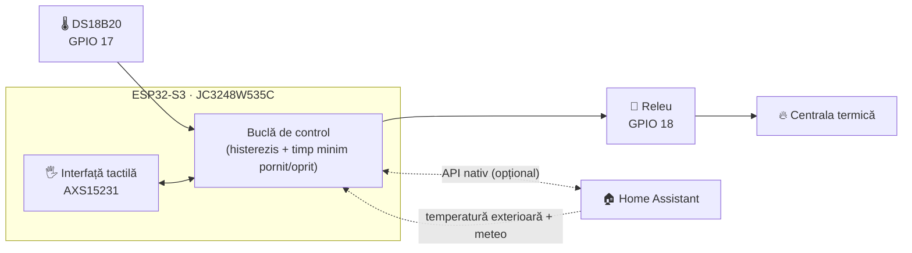

<div align="center">

# 🔥 Termostat ESP32-S3 cu ecran tactil

### Termostat ESPHome autonom și controler pentru centrala termică, cu ecran tactil de 3,5"

[](https://esphome.io)
[](https://github.com/espressif/esp-idf)
[](https://www.home-assistant.io)
[](https://www.python.org)
[](LICENSE)
[](#️-plan-de-dezvoltare)

| [English](./README.md) | [Română](./README.ro.md) | [Magyar](./README.hu.md)

<br>

<a href="https://www.youtube.com/watch?v=7YacdU6UZSM">
  
</a>

**[▶ Vezi demonstrația pe YouTube](https://www.youtube.com/watch?v=7YacdU6UZSM)**

</div>

---

> [!WARNING]
> **Tensiune de rețea și sistem de încălzire pe gaz. Citește [declinarea responsabilității](#️-declinarea-responsabilității-și-siguranță) înainte de a construi orice.**

## 📑 Cuprins

- [✨ Funcționalități principale](#-funcționalități-principale)
- [🏗️ Arhitectură](#️-arhitectură)
- [📸 Capturi de ecran](#-capturi-de-ecran)
- [📱 Ghidul interfeței tactile](#-ghidul-interfeței-tactile)
- [🧰 Hardware și conexiuni](#-hardware-și-conexiuni)
- [🚀 Instalare](#-instalare)
- [🩺 Depanare](#-depanare)
- [🗺️ Plan de dezvoltare](#️-plan-de-dezvoltare)
- [🤝 Contribuții](#-contribuții)
- [⚠️ Declinarea responsabilității și siguranță](#️-declinarea-responsabilității-și-siguranță)
- [📄 Licență](#-licență)

---

## ✨ Funcționalități principale

| | Funcționalitate | Detalii |
| :-: | :--- | :--- |
| 🧠 | **Buclă de control locală** | Citește DS18B20, evaluează histerezisul și comandă releul direct de pe dispozitiv. Fără cloud, fără server. |
| 📡 | **Funcționează offline** | Wi-Fi-ul sau Home Assistant nu mai funcționează? Termostatul continuă să încălzească și poate fi controlat complet de pe ecran. |
| 🏠 | **Pregătit pentru Home Assistant** | API nativ pentru sincronizarea temperaturii țintă, a modului vacanță, a datelor meteo exterioare și pentru dashboard-uri. |
| 🖐️ | **Interfață tactilă completă** | Ecran principal + meniu de setări, cu tranziții animate și o flacără animată în timpul încălzirii. |
| 🛡️ | **Protecția centralei** | Histerezis și timpi minimi de pornire/oprire configurabili, pentru a evita ciclurile scurte (short-cycling). |
| 💾 | **Setări persistente** | Toți parametrii sunt salvați în memoria flash și se păstrează după repornire sau după o pană de curent. |
| 🌴 | **Mod vacanță** | O singură atingere pentru a trece pe o temperatură economică dedicată. |
| 🔄 | **Actualizări OTA** | Actualizezi firmware-ul fără fir, după ce dispozitivul a fost montat pe perete. |

---

## 🏗️ Arhitectură

Termostatul folosește un **design hibrid**: ESP32-S3 este „creierul”, iar Home Assistant este un strat suplimentar opțional.



**Autonom (fără Home Assistant)**
- Citirea locală a temperaturii, evaluarea histerezisului și comanda directă a releului
- Control manual complet de pe ecran: temperatura țintă, calibrare, histerezis, mod vacanță, luminozitate

**Cu Home Assistant (funcții extinse)**
- Sincronizarea temperaturilor țintă și a modului vacanță
- Temperatura exterioară și pictograma stării vremii (`weather.forecast_home`)
- Monitorizare la distanță și automatizări din dashboard-urile tale

---

## 📸 Capturi de ecran

| Ecranul principal | Meniul de setări |
| :---: | :---: |
|  |  |

<div align="center">

[](https://www.youtube.com/watch?v=7YacdU6UZSM)

*Apasă pe miniatură pentru a vedea navigarea tactilă și flacăra animată din timpul încălzirii.*

</div>

---

## 📱 Ghidul interfeței tactile

Interfața rulează pe un ecran IPS capacitiv de 3,5" (controler `AXS15231`) și este randată cu motorul de afișare ESPHome.

### Ecranul principal

| Element | Descriere |
| :--- | :--- |
| 🕐 **Ceas și dată** | Sincronizate prin SNTP, pentru fusul tău orar |
| 📶 **Rețea și vreme** | Intensitatea semnalului Wi-Fi, plus temperatura exterioară și pictograma vremii (din Home Assistant) |
| 🌡️ **Temperatura din cameră** | Afișaj mare, cu valoarea citită de DS18B20, cu offset de calibrare |
| 🎯 **Temperatura țintă** | Valoarea setată curent (sau cea din modul vacanță) |
| 🔥 **Starea încălzirii** | `ÎNCĂLZIRE` (încălzire activă, cu flacără animată) · `REPAUS` (în așteptare) · `OPRIT` (oprit) |
| ➕➖ **Comenzi rapide** | Ajustezi temperatura țintă în pași de **0,5 °C** |
| ⚙️ **Setări** | Pictograma roată dințată (dreapta sus) deschide meniul de setări |

### Meniul de setări

Toate valorile sunt salvate în preferințele din flash.

| Setare | Interval / Opțiuni |
| :--- | :--- |
| **Unitate de măsură** | °C / °F |
| **Calibrare** | −5,0 °C … +5,0 °C |
| **Histerezis** | 0,1 °C … 2,0 °C |
| **Timp minim** (pornit/oprit) | 0 … 600 s |
| **Mod Vacanță** | PORNIT / OPRIT |
| **Temp. Vacanță** | 5,0 °C … 20,0 °C |
| **Luminozitate** | 10 % … 100 % |
| **Afișarea temperaturii exterioare** | Afișată / ascunsă pe ecranul principal |

---

## 🧰 Hardware și conexiuni

### Lista de componente

| Componentă | Note |
| :--- | :--- |
| **JC3248W535C** | Placă ESP32-S3 cu ecran IPS capacitiv tactil de 3,5" |
| **DS18B20** | Senzor de temperatură 1-Wire |
| **Rezistor 4,7 kΩ** | Pull-up între DATA și 3,3 V |
| **Modul releu** | Dimensionat pentru circuitul de comandă al centralei tale |
| **Sursă de alimentare 5 V** | Alimentare stabilă pentru placă |

### Alocarea pinilor

| Componentă | Pin / Interfață | Descriere |
| :--- | :--- | :--- |
| **Ecran** | `JC3248W535C` | Ecran IPS capacitiv tactil de 3,5" (QSPI) |
| **Controler tactil** | `AXS15231` | Interfață tactilă capacitivă integrată |
| **PWM iluminare fundal** | `GPIO 1` | Controlul luminozității prin LEDC |
| **DS18B20** | `GPIO 17` | Linie de date 1-Wire (necesită pull-up de 4,7 kΩ) |
| **Releu încălzire** | `GPIO 18` | Ieșire digitală către modulul releu al centralei |
| **Magistrală I²C** | SDA `GPIO 4` · SCL `GPIO 8` | Senzori opționali (de ex. SHT45 / BME280) |
| **Magistrală SPI (ecran)** | CLK `GPIO 47` · Date `[21, 48, 40, 39]` | Quad SPI pentru randare rapidă |

### Conectarea DS18B20

```text
 3,3V ──┬───────────── VCC (DS18B20)
        │
      [4,7kΩ]
        │
 GPIO17 ┴───────────── DATA (DS18B20)

 GND ────────────────── GND (DS18B20)
```

> [!CAUTION]
> **PERICOL ELECTRIC: tensiune de rețea de 230 V**
> - Conectarea releului la sistemul de încălzire implică lucrul cu tensiune de rețea.
> - Deconectează de la rețea **atât** centrala, cât și sursa de alimentare a termostatului, înainte de a atinge orice conexiune.
> - Dacă nu ești sigur sau nu ești calificat, **apelează la un electrician autorizat**.

---

## 🚀 Instalare

**Mediul testat**

| Instrument | Versiune |
| :--- | :--- |
| Sistem de operare | Windows, Linux sau macOS (terminal) |
| Python | `3.11.6+` |
| ESPHome | `2025.11.0+` |
| Framework | `ESP-IDF` (configurat automat prin `platformio_options` în fișierul YAML) |

### 1️⃣ Clonează repository-ul

```bash
git clone https://github.com/DaradiciLevente/jc3248w535c-esphome-termostat.git
cd jc3248w535c-esphome-termostat
```

### 2️⃣ Configurează `secrets.yaml`

Creează sau actualizează fișierul `secrets.yaml` în directorul tău de configurare ESPHome:

```yaml
wifi_ssid: "Your_WiFi_SSID"
wifi_password: "Your_WiFi_Password"
ap_ssid: "Thermostat-Fallback-AP"
ap_password: "Fallback_Password"
api_password: "Your_ESPHome_API_Password"
ota_password: "Your_OTA_Password"
api_key: "Your_Encryption_Key_Base64"
```

> [!TIP]
> **Generează o cheie de criptare API validă** (32 de octeți aleatori, codați în base64):
> ```bash
> python -c "import base64, os; print(base64.b64encode(os.urandom(32)).decode())"
> ```

### 3️⃣ Setează entitățile din Home Assistant

Editează blocul `substitutions` de la începutul fișierului YAML:

```yaml
substitutions:
  sensor_temp_exterior: "sensor.your_outdoor_temperature_sensor"
  sensor_stare_vreme: "weather.forecast_your_home"
```

### 4️⃣ Compilează și flashează

Conectează placa prin USB și rulează:

```bash
esphome run termostat-esphome.yaml
```

> [!NOTE]
> După primul flash, odată ce dispozitivul este în rețeaua ta, actualizările ulterioare se fac **prin aer (OTA)**.

---

## 🩺 Depanare

<details>
<summary><b>🌡️ DS18B20 afișează <code>85.0 °C</code> sau <code>--.-</code></b></summary>

<br>

**Cauză:** `85.0 °C` este valoarea implicită a cipului la pornire și indică o problemă de comunicație sau de cablare.

**Soluție:**
- Verifică cablarea pe `GPIO 17`.
- Asigură-te că un **rezistor pull-up de 4,7 kΩ** leagă linia DATA de 3,3 V.
- Verifică dacă senzorul primește o alimentare stabilă de 3,3 V.
- Firmware-ul filtrează valorile de `85.0 °C` și pe cele din afara intervalului, dar o cablare corectă rămâne esențială.

</details>

<details>
<summary><b>🖥️ Ecranul rămâne negru sau atingerea nu răspunde</b></summary>

<br>

**Cauză:** definiții greșite ale pinilor sau o nepotrivire în configurația SPI/ecran.

**Soluție:**
- Confirmă că placa ta este exact **JC3248W535C** (ESP32-S3, ecran QSPI, touch `AXS15231`).
- Verifică pinii SPI (`CLK: 47`, Date: `[21, 48, 40, 39]`) și pinii I²C (`SDA: 4`, `SCL: 8`) față de revizia PCB-ului tău.
- Inspectează logurile seriale pentru bucle de repornire sau erori de driver:
  ```bash
  esphome logs termostat-esphome.yaml
  ```

</details>

<details>
<summary><b>📶 Conectarea la Wi-Fi eșuează la pornire</b></summary>

<br>

**Cauză:** credențiale greșite în `secrets.yaml` sau semnal slab.

**Soluție:**
- Verifică din nou `wifi_ssid` și `wifi_password`.
- Dacă rețeaua principală nu poate fi atinsă, dispozitivul pornește propriul punct de acces de rezervă (`ap_ssid`). Conectează-te la el pentru a verifica logurile sau pentru a actualiza credențialele prin OTA.

</details>

---

## 🗺️ Plan de dezvoltare

Proiectul este în dezvoltare activă. Documentația și funcționalitățile sunt încă în evoluție.

- [x] Buclă de control locală cu histerezis și timp minim pornit/oprit
- [x] Interfață tactilă cu meniu de setări și flacără animată
- [x] Mod vacanță și setări persistente
- [x] Integrare cu Home Assistant (vreme + sincronizare)
- [ ] Senzori I²C opționali (SHT45 / BME280)
- [ ] Program săptămânal
- [ ] Mai multe limbi pentru interfață

*Editează această listă conform planurilor tale reale.*

---

## 🤝 Contribuții

Contribuțiile, raportările de probleme și cererile de funcționalități sunt binevenite! Consultă [pagina de issues](../../issues).

1. Fă un fork al proiectului
2. Creează o ramură pentru funcționalitatea ta: `git checkout -b feature/AmazingFeature`
3. Fă commit modificărilor: `git commit -m 'Add some AmazingFeature'`
4. Trimite ramura în repository: `git push origin feature/AmazingFeature`
5. Deschide un Pull Request

---

## ⚠️ Declinarea responsabilității și siguranță

> [!WARNING]
> - Acesta este un **proiect DIY, realizat ca hobby**. Implică electronică sensibilă, **tensiune de rețea periculoasă de 230 V** și **sisteme de încălzire pe gaz**.
> - Este oferit **exclusiv în scop educativ și experimental**, distribuit **„CA ATARE” („AS IS”)**, fără niciun fel de garanție, expresă sau implicită.
> - Autorul **nu** recomandă, nu susține și nu garantează utilizarea lui în instalații reale, de producție sau casnice.
> - Autorul **nu își asumă nicio răspundere legală sau obligație** pentru daune directe sau indirecte, pierderi materiale, vătămări corporale sau accidente rezultate din utilizarea, folosirea necorespunzătoare sau implementarea acestui proiect.
> - Prin descărcarea, clonarea sau utilizarea oricărei părți din acest cod sau din această documentație, recunoști că ești **singurul responsabil** pentru respectarea reglementărilor locale privind siguranța și instalațiile electrice și îți asumi **100% din risc și din răspunderea legală**.

---

## 📄 Licență

Distribuit sub **Licența MIT**. Consultă fișierul [`LICENSE`](LICENSE) pentru detalii.

---

<div align="center">

*Creat cu pasiune pentru makeri, pasionați de DIY și entuziaști ai casei inteligente.*

**Realizat de [Levente Daradici](https://github.com/DaradiciLevente)** 🚀

⭐ Dacă acest proiect ți-a fost de folos, gândește-te să-i dai o stea!

</div>
